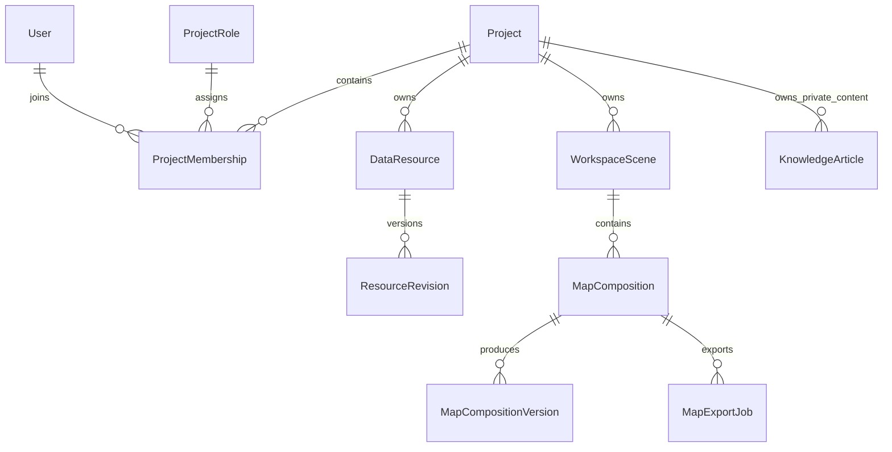

# 时空智能服务平台：三项新增需求分析与开发计划

> 历史稿，已被 `docs/platform-upgrade-development-plan-v2.md` 替代。执行以 v2 和 `docs/platform-upgrade-execution-backlog.md` 为准；本稿中关于超管访问、公开默认项目、首页、素材来源、输出限制、历史迁移和人员工期的建议不再作为当前基线。

版本：v0.1 审阅稿｜编制日期：2026-09-18｜建议审阅日期：2026-09-19

适用范围：科普与学习中心、项目隔离与数据架构、在线制图工作台。

文档状态：供需求和技术路线决策，尚未批准实施。本文基于当前工作区源码和设计文档核查；没有对生产数据量、部署硬件或用户并发进行实测。所有工期、容量与性能指标均为待验证的规划值。本文中的新表、接口和目录是拟议设计，不代表已实现。

## 1. 审阅结论与建设顺序

建议将三项需求作为一次平台级升级：以“业务项目”作为人员、数据与成果的共同边界，把科普栏目升级为分方向学习中心，在现有专题出图能力上增加可拖拽的版面编辑器。

推荐实施顺序为：**确认项目边界与数据库方案 → 落实服务端隔离和迁移 → 上线学习中心 → 交付拖拽制图 → 质量验收与分批上线。** 学习内容整理、编辑器交互原型可以与权限基础开发并行，但连接真实数据的制图与学习案例必须经过项目授权。

| 需求 | 当前基础 | 核心新增工作 | 推荐交付边界 |
| --- | --- | --- | --- |
| 科普模块 | 胡杨物种、保护案例、论文与知识图谱内容 | 多方向分类、基础知识、学习链接、学习路径、内容维护和项目可见性 | 首期 6 个方向、每方向 3 篇基础文章及 5 个学习链接；方向名单待审阅 |
| 项目隔离 | Django 用户/角色权限、资源访问组、地图工程 | 独立业务项目、项目成员与角色、所有业务入口隔离、数据库和文件迁移 | 一人多项目、项目内角色、默认拒绝跨项目访问、平台公共内容显式发布 |
| 在线制图 | 标准版式、地图要素、草稿、成果版本、PNG/JPG/PDF | 可选择和拖拽的元素、缩放旋转、对齐吸附、撤销重做、保存恢复、稳定导出 | 首期覆盖常用二维布局制图；专业投影、多地图框和批量图集分期推进 |

“类似 ArcGIS”建议定义为**复现常用布局制图工作流和成果质量**，以具体功能及样图验收。完整桌面 GIS 的分析、编辑、地理数据库、三维、插件和工程格式兼容是另一量级的建设，不能仅凭“复刻 ArcGIS”形成可执行工期。

“整个数据库结构都要更新”应落实为**全库逐表梳理、明确归属、更新关联约束和访问链路**。账号、系统设置、标准词典等平台级表应继续共享，不机械地给所有表增加项目字段，也不需要重建整个系统。

## 2. 当前系统核查与差距

### 2.1 已确认的实现基础

| 核查项 | 源码证据（仓库内相对路径） | 对改造的影响 |
| --- | --- | --- |
| 平台定位 | `frontend/src/config/platformBrand.ts` 已使用“时空智能服务平台” | 新科普栏目应面向通用时空技术；胡杨内容保留为生态方向案例 |
| 科普内容 | `frontend/src/pages/KnowledgePage.tsx`、`frontend/src/about/aboutSections.ts`、`frontend/src/pages/EnglishEditorialPages.tsx` | 主要由前端静态内容组织，中英文存在独立页面实现；需统一内容模型，减少两套维护 |
| 技术栈 | `AGENTS.md`、`README.md`、`frontend/package.json` | 保留 React、Ant Design、Mapbox GL、Django、后端栅格渲染体系 |
| 当前权限 | `backend/apps/catalog/permissions.py` | 以全局 Group 和对象访问组为主；平台管理员存在全量数据访问逻辑，不能直接沿用到项目隔离 |
| 地图工程 | `backend/apps/catalog/models.py` 中 `WorkspaceScene` | 当前“工程”保存地图工作台快照，不具备业务项目成员和隔离能力 |
| 出图数据 | 同文件中 `MapComposition`、`MapCompositionVersion` | 已有草稿、不可变成果版本、发布和快照，适合扩展 |
| 固定版式编辑 | `frontend/src/components/map-composition/MapCompositionEditor.tsx`、`frontend/src/map-composition/layoutTypes.ts` | 当前预览为合成图片；虽有毫米坐标，仍需实现真正的元素选择与拖拽画布 |
| 当前导出 | `frontend/src/map/mapExport.ts`、`backend/apps/catalog/map_compositions.py` | 前端合成 PNG 母图，后端 Pillow 输出文件；当前 PDF 属于图像型 PDF，不能按全矢量 PDF 验收 |
| 导出限制 | 同上及 `docs/implementation-notes.md` | 当前有单边 8192 像素、总计 3600 万像素限制；600 DPI 大幅面不能直接承诺 |
| 科研存储 | `backend/apps/core/storage.py`、`README.md` | 当前统一 `vector/vector.gpkg` 及固定栅格目录，需要项目化路径与引用迁移 |
| 业务关联 | `backend/apps/ecology/models.py`、`backend/apps/omics/models.py`、`backend/apps/standards/models.py` | 生态、组学和来源追溯数据也必须纳入项目归属，不能只修改目录表 |

设计文档中的部分内容仍沿用胡杨平台的初始范围，而当前代码已经实现部分后续能力。开发基线应以实际代码、权威 API 契约和本次批准后的范围共同确认，不能把已有能力重新计算为从零开发。

### 2.2 当前不足与本次需要解决的问题

1. 知识栏目与平台通用定位不匹配，缺少按方向、难度、资源类型组织的持续维护机制。
2. 全局角色无法表达“张某在项目 A 是管理员，在项目 B 只能浏览”。
3. 地图工程的 `project` 命名与新增业务项目容易混淆，必须在数据库和界面上明确区分。
4. 只过滤列表仍可能通过对象 ID、文件地址、瓦片、统计、历史快照或后台任务访问其他项目内容。
5. 固定版式预览无法满足拖拽排版；现有 PDF 和高 DPI 限制需要透明表达。
6. 现有源码测试可作为回归基础，但本文未运行应用测试，也不将代码存在视为线上验收通过。

## 3. 用户、术语与共同规则

### 3.1 核心术语

| 术语 | 定义 | 示例 |
| --- | --- | --- |
| 业务项目 `Project` | 人员、权限、数据、知识和成果的归属边界 | “矿产资源遥感调查”“生态环境监测” |
| 地图工程 `WorkspaceScene` | 一个项目内保存图层、样式和视角的工作状态 | “研究区地质底图工程” |
| 出图稿 `MapComposition` | 地图工程上的可编辑纸面布局 | “2026 年土地覆盖图 A3 横版” |
| 成果版本 `MapCompositionVersion` | 某次导出的不可变文件及其快照 | “土地覆盖图 V3，300 DPI” |
| 平台公共内容 | 经明确发布、可按受众规则访问的知识或成果 | 遥感入门教程、已审核的公开成果图 |

### 3.2 主要用户故事

- 新成员进入学习中心，按方向完成“基础概念 → 推荐材料 → 示例实践”，能识别资料的难度、语言和适用软件版本。
- 同一用户加入多个项目，切换后只看到当前项目的数据、工程、任务与成果；项目间同名资源不互相覆盖。
- 项目管理员为项目成员分配角色，无法修改其他项目成员或赋予平台管理权。
- 科研人员从已授权图层建立地图工程，拖动标题、地图框、图例等元素，导出可直接用于报告的地图。
- 平台运维人员管理部署和账号；读取项目内容需要明确的项目授权或受审计的应急访问。

### 3.3 统一产品规则

- 项目状态为“筹备、启用、归档”；归档后保持授权只读，禁用新增、修改和新导出任务。历史文件是否允许继续下载按项目策略处理，默认允许原授权成员下载。
- 用户可加入多个项目；每个项目首期分配一个预设角色，后续再开放角色组合与自定义角色。
- 个人草稿归属项目且默认仅作者和有内容管理权的项目管理员可见；共享、发布是显式操作。
- 首期项目之间不共享原始私有数据。平台公共知识独立管理；项目成果如需公开，应产生经审核的发布快照。
- 中文为首期完整交付语言；英文内容按已翻译条目提供，缺失时明确显示“暂无英文版本”，不得展示旧页面冒充新内容。
- 所有删除、成员移除、发布和归档操作有审计记录。项目首期不提供一键物理销毁全部数据。

## 4. 需求一：科普与学习中心

### 4.1 栏目定位与方向建议

建议一级导航使用“科普与学习”，在保留专业内容的同时面向入门学习。方向不是写死的代码枚举，应支持管理员排序、停用和新增。依据当前团队研究介绍，建议以下 6 个初始方向，由你在审阅时确认。

| 方向 | 基础知识建议 | 入门实践示例 | 候选资料来源 |
| --- | --- | --- | --- |
| 遥感基础与影像解译 | 光谱、分辨率、传感器、预处理、分类与精度评价 | 理解土地覆盖分类图与混淆矩阵 | NASA ARSET、ESA 培训资料 |
| GIS 与地图制图 | 坐标系与投影、矢量/栅格、图层、符号化、比例尺与版式 | 制作带图例与比例尺的研究区图 | QGIS 培训手册、ArcGIS Pro 官方帮助 |
| 时空数据与智能分析 | 时空索引、时序变化、空间关联、数据融合、训练与推理 | 阅读地表变化序列并解释结果 | GeoPandas、xarray、PyTorch 官方教程 |
| 地质与自然资源遥感 | 高光谱、矿物光谱、蚀变、地质解译、找矿预测 | 认识矿物光谱和专题图证据 | USGS 光谱资料、地学公开数据说明 |
| 农业生态与环境监测 | 植被指数、作物识别、土地退化、碳汇、生态监测 | 从植被指数理解季节变化 | FAO、NASA Earthdata 等公开资料 |
| 多模态与地学智能体 | 多模态输入、检索增强、工具调用、评测与不确定性 | 阅读一个地学问答或分析案例 | PyTorch、Hugging Face 官方课程 |

以上为内容策划建议，不代表已完成专业审校。胡杨物种、保护管理和已有论文内容迁入“农业生态与环境监测 / 胡杨生态案例”，保留原地址跳转和来源信息。

### 4.2 页面与访问流程

```text
科普与学习首页
  ├─ 方向导航、关键词搜索、难度/语言/资源类型筛选
  ├─ 方向页：简介 → 基础知识 → 学习路径 → 推荐链接 → 示例案例
  ├─ 文章页：学习目标、正文、术语、图示、参考来源、相关材料
  └─ 项目学习区：项目培训材料、项目规范、已授权数据案例
后台内容管理
  └─ 编辑 → 提交审核 → 发布 → 更新/下架
```

学习中心明确显示“平台公共”或“当前项目”。公共文章引用私有数据时不能直接展示数据名称、预览或附件；发布校验要求替换为公共示例或移除引用。文章附件、缩略图和站内搜索使用与正文相同的权限。

### 4.3 功能需求与优先级

本文 P0 表示首期验收必须具备，P1 表示后续增强。

| 编号 | 优先级 | 需求 | 验收要点 |
| --- | --- | --- | --- |
| K-01 | P0 | 可配置方向和两级分类 | 新增方向无需发版；空分类有明确状态；分类停用不删除文章 |
| K-02 | P0 | 基础文章 | 标题、摘要、目标、正文、难度、标签、来源、作者、更新时间齐全 |
| K-03 | P0 | 学习链接 | 显示标题、来源机构、简介、类型、语言、难度、访问条件、核验日期 |
| K-04 | P0 | 搜索与筛选 | 按标题、摘要、标签检索；分页和总数只包含可见已发布内容 |
| K-05 | P0 | 线性学习路径 | 每方向至少一条建议顺序；可从基础知识进入实践材料 |
| K-06 | P0 | 内容管理与审核 | 草稿、待审核、已发布、已下架；编辑修订不能直接替换线上已发布版本 |
| K-07 | P0 | 项目学习内容 | 项目内容仅对应成员可访问，公共内容独立授权，不由空项目字段自动公开 |
| K-08 | P0 | 历史内容迁移 | 原胡杨内容保留来源，映射到新分类，旧入口可跳转 |
| K-09 | P1 | 收藏与学习记录 | 用户本人可见；退出项目后不能再读取私有内容 |
| K-10 | P1 | 链接定期检查与反馈 | 检查结果分为可访问、需登录、重定向、失效、待人工确认 |
| K-11 | P1 | 图谱与知识问答 | 在可维护文章和准确引用基础上扩展，另行定义问答评测 |

首期数量建议：6 个方向、18 篇入门文章、30 个学习链接、6 条路径。每篇基础文章建议 800–1500 字，包含至少一个图示或操作示例；内容数量可以审阅时调整，但不能只交付空栏目作为完成。

### 4.4 内容维护规则

每个方向设一名内容责任人，技术开发负责编辑、发布和访问控制，专业人员负责事实核验、概念准确性和学习顺序。候选外链不等于“已验证可用资源”，上线前记录真实标题、落地页、核验日期和访问条件。

候选官方入口如下，仅作建库起点，本轮未联网逐一核验：

- NASA ARSET：<https://appliedsciences.nasa.gov/what-we-do/capacity-building/arset>
- QGIS 培训手册：<https://docs.qgis.org/latest/en/docs/training_manual/>
- ArcGIS Pro 帮助：<https://pro.arcgis.com/en/pro-app/latest/help/main/welcome-to-the-arcgis-pro-app-help.htm>
- GeoPandas：<https://geopandas.org/en/stable/getting_started.html>
- xarray：<https://docs.xarray.dev/en/stable/>
- PyTorch：<https://pytorch.org/tutorials/>
- USGS 光谱库：<https://www.usgs.gov/labs/spec-lab/capabilities/spectral-library>
- Hugging Face 课程：<https://huggingface.co/learn>

外部教材以链接和必要摘要为主；图片、全文、附件记录来源与使用许可。若后续实现服务器主动检查链接，需限制协议、重定向、超时和响应体大小，阻止访问本机及内网地址。首期可以采用人工核验，避免把链接监测系统变成首发依赖。

## 5. 需求二：增加业务项目层级与统一授权

### 5.1 信息架构与项目切换

```text
平台（共享账号、全局配置、公共知识）
  └─ 业务项目 Project
       ├─ 项目成员与角色
       ├─ 数据目录、资源、矢量/栅格和业务记录
       ├─ 地图工程 WorkspaceScene
       │    └─ 出图稿 MapComposition → 成果版本
       ├─ 项目知识与培训资料
       └─ 导入/导出任务、操作日志、项目成果
```

登录后：只有一个可用项目时直接进入；有多个时显示项目选择页并记忆最近选择；没有项目时进入公共学习与“申请加入/联系管理员”提示页。全站顶部显示当前项目，数据页面的深链接包含项目标识。

切换项目必须处理未保存草稿，取消旧请求、清空地图图层和选中资源、重建查询缓存。URL 为项目上下文的明确来源，后端逐次校验，不依赖全局 Session 中可被另一个浏览器标签页覆盖的“当前项目”。保存的偏好仅用于初始导航，不作为授权依据。

### 5.2 角色矩阵（推荐默认值）

| 操作 | 浏览者 | 研究成员 | 数据管理员 | 项目管理员 | 平台运维管理员 |
| --- | --- | --- | --- | --- | --- |
| 浏览项目共享内容 | 是 | 是 | 是 | 是 | 需另行授权 |
| 建立个人地图工程/出图稿 | 否 | 是 | 是 | 是 | 需另行授权 |
| 导出地图或下载原始数据 | 否 | 按项目许可 | 按项目许可 | 按项目许可 | 需另行授权 |
| 导入、维护项目数据 | 否 | 否，可后续申请 | 是 | 是 | 需另行授权 |
| 编辑项目学习资料 | 否 | 可提稿 | 可提稿 | 是 | 需另行授权 |
| 审核项目知识与成果发布 | 否 | 否 | 否 | 是 | 需另行授权 |
| 管理项目成员与角色 | 否 | 否 | 否 | 是 | 可管理项目生命周期，内容访问另授权 |
| 修改平台配置和账号体系 | 否 | 否 | 否 | 否 | 是 |

角色与下载权限分别控制，能看地图不自动等于能下载源数据。平台内容管理员可维护公共知识，不自动拥有项目数据权限。保留应急超级管理员能力，但通过受控管理入口使用，记录操作者、访问项目、原因和时间；正常浏览链路不静默继承全量绕过。

项目内至少保留一名启用的项目管理员；最后一名管理员不能自行退出或被移除，需先完成交接。成员被移除后，作品留在项目中并保留作者记录，管理权交接给项目管理员；原作者不再因 `owner` 或 `maintainer` 身份获得访问权。

### 5.3 授权判定与接口行为

项目私有内容的有效授权应同时满足：

```text
账号有效
AND 项目状态允许当前操作
AND 用户具有该项目的有效成员身份（或显式应急授权）
AND 项目角色包含该操作权限
AND 对象属于当前项目
AND 对象共享范围与所有依赖资源均允许该操作
```

公共发布内容走独立的发布授权链路，不能使用“没有访问组”或“project_id 为空”推断公开。全局 Django Group 保留为平台角色或项目角色模板来源；项目角色的实际权限经 `ProjectMembership → ProjectRole → Django Permission` 计算，不能把项目管理员加入全局管理员组。

建议所有项目业务接口显式携带项目路径 `/api/projects/{projectId}/...`。创建时由服务端从已验证路径写入归属，拒绝载荷中矛盾的项目 ID。嵌套引用检查资源、图层、工程、成果、父目录是否属于同一项目；批量接口、导入和管理命令使用同一服务层约束。

未登录返回 `401`；有成员身份但缺少操作权限返回 `403`；非成员访问项目或对象、对象属于其他项目时返回不暴露存在性的 `404`。错误沿用 `{"detail":"..."}` 结构。普通项目管理员不能经后台接口、Django admin 或批量接口绕过范围校验。

### 5.4 必须覆盖的隔离面

| 隔离面 | 改造要求 |
| --- | --- |
| 列表、搜索、统计与自动补全 | 查询先限定项目再聚合、计数、分页；不泄露他项目名称或数量 |
| 对象详情与关系选择器 | 已知对象 ID、关联下拉框、元数据、字段画像也要校验 |
| 空间/非空间查询与 AI 分析入口 | SQL、GeoPackage 图层和 AI 上下文只能来源于已授权资源 |
| 地图图层与栅格瓦片 | 每次请求或有效授权窗口检查，不能只在获取图层列表时检查 |
| 文件、缩略图和导出下载 | 私有文件通过鉴权服务访问，不直接挂到匿名静态目录 |
| 导入/导出及处理任务 | 保存项目、提交者与输入清单；执行前、输出前和下载时重新检查 |
| 快照、成果版本与恢复 | 深入检查 JSON 内引用；旧快照不能绕过撤权恢复私有图层 |
| 缓存与浏览器存储 | 缓存键包括项目及资源版本；权限响应另含用户或权限版本，切换时清理旧状态 |
| 审计与后台统计 | 项目管理员只看本项目可见日志；平台统计使用专门权限 |
| 备份与恢复 | 平台整库备份仅平台授权人员获取；项目恢复按项目清单校验依赖 |

撤权语义：提交成员或角色变更后，新 API 请求立即按新权限判断；正在运行的任务在检查点终止并禁止发布/下载。首期私有文件优先采用受鉴权代理；若未来改为签名链接，需单独定义短有效期及撤销机制。已经下载到用户设备的文件无法被技术上收回，应在审阅时接受这一边界。

## 6. 数据库与文件存储改造

### 6.1 推荐架构及替代路线

| 路线 | 优点 | 成本与限制 | 建议 |
| --- | --- | --- | --- |
| 同库同表 + 项目字段 | 复用 Django，统一账号和维护，跨表约束清晰 | 所有入口必须完整执行项目过滤；单个漏口可能越权 | 首期推荐 |
| 每项目独立数据库 | 存储边界更强，部分备份操作独立 | 数据迁移、连接管理、全局账号和多库事务明显复杂 | 有强物理隔离要求再选 |
| 每项目独立部署 | 故障域与配置完全独立 | 成本高，统一门户和更新运维复杂 | 特殊部署需求单独立项 |

业务库引擎与隔离方式分开决策。首期可基于 SQLite 实现逻辑隔离；面向持续多人编辑、多导入任务和制图任务的生产环境，建议优先评估 PostgreSQL。是否切换在第 1–2 周以并发写入、迁移演练和运维条件确认，不能把 SQLite 承载能力写成已知瓶颈。PostGIS 仅在明确需要数据库内空间查询时引入，项目隔离本身不要求所有 GeoPackage 数据搬入 PostGIS。

若批准 PostgreSQL，与新架构一起在预发布环境演练并统一切换；若不批准，保留 SQLite，限制并发写任务并给出实测容量。PostgreSQL 行级安全可作为额外防线，但需要处理连接池、后台任务和管理连接上下文，不替代应用授权，也不作为默认已实现能力。

### 6.2 新增核心实体（逻辑设计）

| 实体 | 关键字段/关系 | 约束或说明 |
| --- | --- | --- |
| Project | UUID、code、name、description、status、created_by、timestamps | code 全局唯一；默认归档而非物理删除 |
| ProjectRole | key、name、permissions | 首期平台统一预设角色模板，关联 Django Permission |
| ProjectMembership | project、user、role、status、joined_at、revoked_at | `(project,user)` 唯一；项目角色在成员关系中生效 |
| ProjectPolicy | project、download/export 配置、额度、权限版本 | 与项目一对一；不能由普通成员修改 |
| KnowledgeCategory | code、parent、sort_order、status | 公共方向词典，不携带私有内容 |
| KnowledgeArticle | scope、project、category、title、status、published_revision | 平台或项目归属互斥；公开由发布状态与受众决定 |
| KnowledgeRevision | article、revision、body、sources、reviewer、status | 已发布版本不可原地覆盖，修订走新版本 |
| LearningResource | scope、project、title、url、type、difficulty、language、checked_at、status | 私有链接描述也按项目过滤 |
| LearningPath / LearningPathItem | scope、project、name；path、position、article/resource | 引用不得扩大内容可见范围 |
| LayoutTemplate | scope、project、schema_version、layout、owner | 首期公共模板由平台维护，用户模板默认项目私有 |
| MapExportJob | project、composition、revision、requester、status、progress、error、outputs | 生命周期 queued/running/succeeded/failed/cancelled；输入冻结与幂等 |
| ResourceRevision | resource、revision、checksum、storage_ref、metadata | 至少记录出图所用不可变标识，区分数据变更与版式变更 |

新建 `Project` 与现有 `WorkspaceScene` 是一对多。关系示意：



### 6.3 全库归属与改造清单

| 现有表/模型族 | 拟处理方式 | 必须同步处理的关系 |
| --- | --- | --- |
| Django User、UserProfile、Group、Permission | 保持平台级 | 不复制账号；全局组不作为项目成员依据 |
| RoleApplication | 现有平台角色申请保留 | 项目加入申请若首期需要，新增独立类型和项目上下文 |
| SystemSetting、FeaturePermission | 平台级 | 区分平台配置权限与项目策略权限 |
| DictionaryItem、FieldDefinition、Taxon、TaxonAlias | 经检查确认为通用词典的保留全局 | 移出夹带的项目备注；项目自定义词典另存扩展，不能修改公共标准 |
| DataResourceGroup、DataCatalog、DataResource、MapLayer | 增加非空业务项目外键 | 父子目录、分组、目录资源多对多、图层资源必须同项目 |
| WorkspaceScene | 增加非空业务项目外键 | 作者不替代成员身份；快照内资源引用重新校验 |
| MapComposition | 原 `project` 外键更名为 `workspace_scene`；新增真正的项目外键 | 旧唯一约束改为项目/工程范围；服务端保证工程归属一致 |
| MapCompositionVersion | 可从出图稿继承归属；高频独立查询时冗余项目字段 | published_version 必须属于同一出图稿；快照、资源清单和文件同项目 |
| ResultArtifact | 增加业务项目 | 作者、发布受众、附件和成果来源一致 |
| VectorDataset、RasterDataset | 独立可访问的数据集必须明确项目 | 不能依赖可空或 SET_NULL 的资源关系推导权限；资源解绑后仍保留归属 |
| RasterBand、RasterStyle | 从父数据集继承，独立端点强制关联过滤 | 公共样式模板与项目样式分开，不能泄露统计值 |
| RasterProcessingJob | 增加项目、提交者、输入资源版本 | 任务状态、日志、临时产物和结果受同一授权约束 |
| StudyArea、Site、SurveyEvent、PopulationUnit、SamplePlot、IndividualOrganism | 项目业务记录增加归属 | 区域、地点、样地、个体之间禁止跨项目误关联 |
| CommunitySurvey、SpeciesComposition、CommunityMetricValue、TraitObservation、FieldObservation、SurveyRoute、SpecimenRecord | 跟随项目业务聚合归属，独立查询根显式记录项目 | 子表可沿非空父关系继承，导入写入和反向查询都要检查 |
| RemoteSensingProduct、RasterSampleValue | 明确项目，关联已授权资源 | 栅格、样方和采样结果同项目 |
| BiologicalSample、GermplasmAccession、MolecularSample/Assay/Result/File | 项目业务记录及其文件纳入归属 | 样品、个体、来源表、文件之间不能跨项目关联 |
| GenomeDataset、SequencingRun、GenomeSequenceFile、GenomeAssembly、VariantDataset、GenomeAnnotation | 数据集根显式项目，子记录继承或冗余 | 下载和查询不得仅依赖子对象 ID |
| ResourceDomain、SourceDataset、SourceSheet、SourceFieldMapping、CoordinateParseRecord、DataQualityIssue、SourceRecordLink | 纳入标准化导入与追溯链隔离 | 错误行、源文件名称、字段映射同样可能含私有信息 |
| OperationLog、UserActivityHour | 增加项目上下文；平台事件显式标记为 platform scope | 历史日志不明确归属时仅平台可见；聚合唯一键加入 scope/project |
| BackupRun | 平台完整备份维持平台级，预留明确备份范围字段 | 项目备份不可引用整库归档；自动恢复按范围校验 |

开发前根据 Django 实际模型、迁移和物理业务表导出完整机器清单，包含应用管理的非 ORM 表、索引、视图和文件引用。上表是覆盖范围设计，不替代逐表迁移映射和真实数据盘点。

### 6.4 字段、索引和一致性原则

1. 项目业务根对象 `project_id` 最终必须非空并有索引；只有经过定义的“平台级/项目级”混合实体允许空值，且通过 `scope` 和数据库 CHECK 约束表达合法组合。
2. 资源、图层、目录等当前全局唯一的业务编码，改为 `(project_id, code)` 唯一；项目 UUID 与用户 ID 仍全局唯一。样品编号、地点编码等也要逐一审核，保留真正的全球标准标识。
3. 热门列表建议索引 `(project_id,status,updated_at)`；业务唯一性、父子目录以及中间表约束同步修改，不只增加单列索引。
4. 单纯两个外键不能保证同项目关系。用统一写入服务校验所有跨对象引用；选定数据库后对关键关系补充可行的复合约束/触发器，并以集成测试覆盖批量写入、导入和管理入口。
5. 关键项目和数据归属使用 PROTECT 或受控归档。作者账号停用不删除作品，成员关系撤销不级联删除项目数据。
6. 个人编辑权限和共享范围保持独立。项目成员身份是最外层门槛，现有 `access_groups` 需要映射为项目内共享规则，不能保留全局管理员/维护者自动跨项目访问。
7. 混合 scope 实体的唯一性使用分条件约束，处理 SQL NULL 唯一语义，避免公共分类/模板重复。

### 6.5 文件路径、GeoPackage 与缓存

建议在 TOML 指定的根目录之下增加固定项目分区，项目标识使用不可变 UUID，不使用可修改的项目名：

```text
research_data_root/projects/{projectId}/
  vector/vector.gpkg
  vector/original/
  raster/original/、raster/preprocessed/、raster/metadata/
  gene/、table/
app_data/projects/{projectId}/
  exports/、uploads/、thumbnails/、job-temp/
app_data/cache/projects/{projectId}/...
```

这是对当前统一存储约定的显式变更，需要同时更新存储工具、配置说明、导入扫描、清理、备份和恢复。数据库保存受控相对路径，访问时先授权再解析；项目目录分开本身不构成访问控制。

GeoPackage 推荐每项目一个文件，减少同名图层冲突和混合导出风险；同一项目仍存在文件写锁约束，导入队列需串行化该文件的写任务。缓存键至少包含项目、资源版本、样式哈希、渲染器版本、瓦片坐标/输出尺寸；权限敏感响应另使用用户或授权版本隔离。全局底图缓存仅允许承载明确的公共底图。

### 6.6 历史数据迁移与回退

| 步骤 | 具体动作 | 放行条件 |
| --- | --- | --- |
| M0 盘点 | 导出所有模型、记录量、业务表、文件清单、访问组、快照引用和任务状态 | 每个对象有可追踪 ID；形成归属映射表及疑点清单 |
| M1 备份 | 同一一致性时间点备份业务库、GeoPackage、科研文件、成果、TOML；做恢复演练 | 数据库可恢复，抽样文件哈希一致，恢复耗时实测 |
| M2 归属确认 | 建立真实项目及旧对象→项目映射 | 不能仅按原全局角色猜测项目；不明确对象进入受限待分配项目 |
| M3 扩展模型 | 新建项目/成员表，为业务表增加暂时可空归属字段 | 旧数据仍可盘点；只在隔离预发布环境推进，不放出未隔离的新接口 |
| M4 回填关系 | 按确认映射回填、重建项目内角色、修正唯一键和中间表 | 私有业务根对象无空归属；跨项目关系为零或被明确拆分 |
| M5 文件与快照 | 将图层复制到项目 GeoPackage，复制其他文件，更新路径、JSON 引用及资源清单 | 行数、空间范围、CRS、文件哈希/内容校验通过；同名图层无覆盖 |
| M6 收紧约束 | 非空约束、唯一约束、索引与新权限服务上线 | 全部读写、下载与任务通路经过项目校验 |
| M7 切换 | 维护窗口暂停写入和任务，执行最终增量或完整重跑，切换新代码和目录 | 冒烟测试、权限矩阵、迁移核对通过才恢复写入 |
| M8 观察 | 先选 1–2 个项目试运行，再全量开放 | 无越权，关键查询/导出稳定，备份可恢复 |

首期建议可控维护窗口，不承诺零停机双写。脚本必须支持 dry-run、幂等、检查点和失败报告；先复制并校验文件，再更新引用，不直接原地移动唯一副本。跨项目共用的旧资源须明确拆分为项目副本或进入后续授权共享机制，不能通过同一个裸文件地址继续共用。

回退以“整套版本+数据库+科研文件+成果+配置”恢复为单位。放开新写入前可直接恢复切换前快照；放开后发生故障，必须先冻结写入、保存新产生记录和文件，再决定前向修复或导出增量后回退，不允许无声丢弃用户新数据。旧副本保留期建议 30 天，最终按存储容量和制度确定。

## 7. 需求三：ArcGIS 式在线制图工作台

### 7.1 范围定义与用户流程

本需求中的“拖动制图要素”先定义为拖动纸面上的地图框、标题、图例、比例尺、指北针、图片和说明。移动地理要素坐标、编辑边界和拓扑属于空间数据编辑，应单独确认，不能与纸面排版混用。

标准流程：**选项目 → 打开/新建地图工程 → 选择图层与样式 → 新建出图稿 → 选纸张或模板 → 拖拽排版 → 制图检查 → 保存草稿 → 导出版本 → 下载/项目发布。**

地图浏览与版面设计分为两种模式：普通拖动移动纸面元素；双击地图框进入地图内容模式，此时拖动改变地图范围，退出后回到排版。界面持续显示当前模式，避免“想移动地图框却平移了地图”。

### 7.2 交互布局建议

```text
顶部：项目 / 工程 / 出图稿 / 保存状态 / 撤销重做 / 预览 / 导出
左侧：元素库、图层列表、模板列表
中间：纸张画布、标尺、参考线、缩放、边距与安全区
右侧：选中元素属性（位置、尺寸、字体、样式、关联地图框）
底部：页尺寸、比例尺状态、坐标系说明、校验提示、导出任务
```

编辑器优先支持桌面鼠标与键盘；小屏可浏览成果，首期不把手机专业排版作为必达目标。元素要同时支持拖拽和数值输入，键盘方向键微调，并显示毫米单位。

### 7.3 功能分级

| 编号 | 能力 | 首期正式版 P0 | 后续 P1/P2 |
| --- | --- | --- | --- |
| C-01 | 页面 | A4/A3、横竖版、边距、背景、画布缩放 | A2/A1/A0、自定义尺寸、多页 |
| C-02 | 元素操作 | 选择、拖拽、缩放、复制删除、多选、对齐、分布、层级、锁定、组合 | 更复杂嵌套组合与批量属性 |
| C-03 | 旋转 | 文字/图片/装饰元素旋转；地图框首期北向上 | 地图框内容旋转及对应真北计算 |
| C-04 | 精确排版 | mm 坐标、pt 字号、参考线吸附、边界提示、键盘微调 | 出血区和专业印刷设置 |
| C-05 | 地图框 | 一个主地图框及一个区位图；范围与缩放控制、范围锁定 | 多个独立地图框、裁切形状、系列对比 |
| C-06 | 图例 | 从可见图层派生，分级/唯一值项、排序、名称和列数可调 | 长图例自动跨列/跨页、复杂组合符号 |
| C-07 | 比例尺/指北针/格网 | 绑定地图框、米/千米单位、地理格网与现有投影格网 | 专业投影、真北/格网北选择、多样式 |
| C-08 | 文字与图片 | 标题、副标题、自由文本、来源、制图单位、时间、受控图片 | 图表元素、富文本段落、动态统计 |
| C-09 | 样式 | 复用现有矢量符号化及后端栅格渲染结果 | 比例尺依赖样式、复杂标注避让 |
| C-10 | 编辑历史 | 至少 50 步撤销/重做，草稿自动保存、显式保存、冲突提示 | 多人实时协同、分支合并 |
| C-11 | 模板 | 3 套公共起始模板；项目内另存模板 | 模板市场、跨项目分发审批 |
| C-12 | 导出与成果 | PNG/JPG/图像型 PDF，150/300 DPI，任务状态、取消/重试、版本记录 | 600 DPI、大幅面、矢量或混合 PDF、SVG |
| C-13 | 制图检查 | 缺失图层/字体/来源、越界、图例溢出、低分辨率图片、渲染失败提示 | 规则化出版检查与更多专业约束 |
| C-14 | ArcGIS 工程互通 | 首期不纳入验收 | `.aprx/.mxd/.pagx` 等需单独验证兼容性与使用条件 |

内部试用版可以先完成单元素拖拽、基本属性、保存与导出；正式首期验收仍须包含上表 P0 多选、对齐、撤销等能力，不能将内部演示当作最终交付。

### 7.4 地图准确性和输出口径

1. 页面坐标以 mm 存储，文字以 pt 存储；显示缩放不改变真实布局。导出换算 `像素 = 毫米 ÷ 25.4 × DPI`，不能把低分辨率截图简单放大并标注 300 DPI。
2. 主图与区位图分别持有范围和引用 ID，图例、比例尺与指北针按 `mapFrameId` 绑定，避免未来多地图框绑定混乱。
3. 首期继承 Mapbox Web Mercator 渲染，明确数据坐标系、显示坐标系和输出范围的区别。EPSG:3857 的投影米不能直接当作所有纬度的地面距离。
4. 比例尺以主图指定位置（首期中心纬度）的测地距离推导，标签说明其口径；大范围输出需提示尺度随位置变化。首期不承诺任意投影下固定比例尺的专业工程制图。
5. 北向上地图绑定真北指示；地图旋转与格网北等后续能力必须连同坐标转换一起验证。格网标注也需按实际投影换算，不仅在边框上均匀分隔文字。
6. 数据源或图层授权失效时，草稿可以打开并提示缺失，但禁止把缺失数据的结果无提示地当作完整地图导出。
7. 当前出图链路存在平台默认底图替换。新工作台需明确显示最终输出底图，做到所见所得；第三方底图无法用于正式导出时，在用户确认的可导出底图上重新预览。
8. 输出保留必要的数据来源与底图署名。服务端渲染、瓦片缓存、字体嵌入及商用库选择须在原型阶段确认使用条件和成本，不能预设现有浏览器权限自动覆盖新服务端用途。

以 A3 为例：300 DPI 约 4961×3508 像素（约 1740 万），在现有总像素限制内；600 DPI 约 9921×7016 像素（约 6960 万），同时超出当前单边和总像素限制。首期以 A4/A3、300 DPI 形成稳定闭环，再通过分块渲染和队列容量验证拓展大幅面。

### 7.5 编辑器和渲染技术方案

推荐继续复用 React + Ant Design + Mapbox GL，新增版面交互层。Konva、Fabric 或 SVG 方案做一周内有边界的比较验证，考察 React 集成、多选变换、文字测量、中文字体和导出能力；最终选型以原型结果确定，不因库名先锁定实现。

持久化升级为 `layout.schemaVersion = 2`，以稳定 ID 的 `elements[]` 表达元素：`type、xMm、yMm、widthMm、heightMm、rotation、zIndex、visible、locked、style、mapFrameId`。地图框额外保存数据资源版本、范围、样式、显示投影和底图标识；前后端均校验元素类型、数量、尺寸和 JSON 大小，禁止任意脚本与未经授权的资源 URL。

旧 `layout.version=1` 通过明确迁移器转换，建立标题、主图、图例等元素；保留原始快照用于追溯。生产运行只写新结构，迁移完成后不长期维持两套隐式格式逻辑。现有已导出成果文件保留原样。

撤销重做采用编辑命令或可回滚状态记录；自动保存经防抖后触发，建议操作停止约 3 秒。每次保存携带 `revision/If-Match`，冲突返回 409 或契约规定的 412，并允许用户保留副本或重新加载。多标签页不能无提示覆盖彼此编辑。

渲染分成两条通路：

- 编辑预览：低分辨率地图缓存配合轻量元素画布；拖动标题不重新请求地图瓦片，地图变化才更新对应地图框。
- 正式导出：提交冻结的版式与资源版本，服务端任务复验权限，使用同一版式语义和受控地图渲染环境生成目标分辨率文件。可评估无头浏览器复用现有 Mapbox 渲染；其 WebGL、字体、网络与部署稳定性必须先实测。

继续遵守现有架构：原始栅格符号化、分类和重采样在后端执行，前端只加载已经渲染的影像/瓦片。正式导出不能无条件信任客户端上传任意 PNG 并据此证明数据来源；原型阶段可复用现有路径验证交互，但正式成果需要可校验的生成链。

导出任务使用独立 worker 和持久状态，具体队列技术在第 1–2 周确定。任务包含幂等键、资源配额、超时、取消、有限重试、崩溃恢复和临时文件清理；用户额度与项目额度共同限制，一个项目不能耗尽全部渲染资源。

### 7.6 版本与可复现性

保存版式快照、地图工程快照、资源清单、数据/样式版本、字体信息、渲染器版本、底图来源与时间、输出校验值。对外部实时底图只能承诺记录来源；若未保存合法可复用的底图快照，就不能承诺未来逐像素重建。

区分“重新下载原成果”和“按历史工程重新生成”：前者返回已有不可变文件，后者需要当前资源授权和可用数据版本。原数据更新不覆盖历史文件；原数据删除后可保留已授权成果，但重新生成明确提示缺失依赖。是否继续允许下载旧成果应按成果自身可见性、来源撤销政策统一决定。

## 8. 跨模块系统改进与接口计划

### 8.1 前后端边界

后端建议新增 `apps/projects/` 管理业务项目、成员和授权上下文，新增 `apps/knowledge/` 管理文章与学习资料；目录、地图工程及出图模型继续在 `catalog` 内演进，先拆分服务职责，再决定是否独立 `cartography` app，避免仅为组织代码增加模型搬迁风险。

前端增加项目选择页与项目上下文，统一项目化导航和 API 参数。学习中心从静态内容改为 API 驱动；地图工作台复用现有图层状态，出图编辑器提供独立路由，以便保存、刷新恢复和深链接。

### 8.2 拟议接口分组

下表为讨论路径，不是已发布 API。精确命名、字段、权限和错误在范围批准后进入 `docs/openapi.yaml`。

| 分组 | 拟议接口/动作 | 关键校验 |
| --- | --- | --- |
| 项目 | `GET/POST /api/projects/`；项目详情/更新/归档 | 只列出可加入或已授权的项目，创建需平台权限 |
| 成员 | `/api/projects/{p}/members/`；角色分配/撤销 | 目标项目管理权限、最后管理员保护 |
| 项目业务 | 项目路径下 resources/catalogs/layers/workspaces/compositions | 同项目对象及所有依赖校验 |
| 公共知识 | `/api/knowledge/categories/`、articles/resources/paths | 只返回符合公共发布受众的版本 |
| 项目知识 | `/api/projects/{p}/knowledge/...` | 成员身份、文章状态、附件授权 |
| 出图草稿 | `/api/projects/{p}/compositions/{c}/` | revision 乐观锁、布局 Schema、引用资源 |
| 导出任务 | `POST .../compositions/{c}/exports/`；任务状态/取消 | 202 返回任务 ID，固定输入、幂等与额度 |
| 成果下载 | 项目下受鉴权的版本文件端点 | 版本归属、下载权限和撤权状态 |
| 审计 | 项目日志端点及平台运维端点 | 分离项目日志和平台日志权限 |

现有不带项目的业务 API 不得继续提供全库读取。过渡适配器只在对象可唯一确定项目并完成授权时存在，禁止选择“用户第一个项目”作为默认归属；规定迁移期限后移除，更新现有前端、测试和书签引导。

### 8.3 契约、可观测性与运维

- 按仓库要求依次更新 OpenAPI、开发指南、API 变更记录、Mock 示例、自动生成类型，再实现后端和前端。本工作区实际脚本输出目录是 `frontend/src/api/generated/`，实施时应核对仓库说明中旧 `schema.d.ts` 路径并统一文档。
- 日志包含 request ID、project ID、actor ID、操作、结果和耗时；错误信息不包含原始敏感数据或可直接访问的私有路径。
- 监控拒绝访问数量、项目查询耗时、导出队列长度、任务失败率、缓存占用、数据库锁等待和链接失效数。
- 对导入、导出、存储设置项目额度；额度触发时返回明确说明，允许管理员调整。
- 备份覆盖数据库与文件的一致性关系；首期保障全平台备份恢复，不将可独立恢复任意单项目默认为已有能力。

## 9. 开发计划、人员与工作量

### 9.1 估算前提

建议配置：2 名前端、2 名后端、1 名测试，GIS/渲染专家约 0.5 人投入；产品负责人定期审阅，各方向专家提供内容审核。以下为这套人力下的相对周计划，**不是从文档编写日自动开工**，W1 从需求范围确认和团队到位后计算。

首期正式版预计 12–14 周，内部试用版约第 8–10 周。单名全栈兼任测试无法按此日历排期；若只有两名开发，应按实际有效人日重新分配，初步可能需要约 24–36 周，取决于专职测试/GIS支持和范围裁剪。

| 阶段 | 周期 | 主要任务 | 可审阅交付物/退出条件 |
| --- | --- | --- | --- |
| P0 范围与技术验证 | W1–W2 | 项目隔离矩阵、方向清单、三张目标制图样例、数据盘点；拖拽/字体/300 DPI/投影与 worker 原型 | 批准的需求基线、ERD、迁移映射、技术验证记录；确定数据库与渲染路线 |
| P1 项目基础 | W3–W4 | Project、Membership、Role、统一授权；项目选择器；首批 API 契约 | A/B 项目与多项目用户演示；核心对象越权测试通过 |
| P2 全链路隔离与迁移 | W5–W6 | 目录/数据/栅格/业务表/文件/缓存/任务/日志改造，迁移 dry-run | 所有接口范围盘点闭环；迁移核对报告；预发布环境隔离可用 |
| P3 学习中心 | W3–W7 | 分类、文章、学习链接、审核与项目内容；整理迁移旧内容 | 6 个方向的完整内容清单与页面；专业审核记录；可独立验收 |
| P4 拖拽制图试用 | W5–W10 | 元素模型、交互画布、属性、撤销、保存、地图绑定、模板、导出任务 | 三类样图全流程；W8–W10 内部试用；目标输出完成 |
| P5 集成与正式验收 | W11–W12 | 全量权限回归、迁移/恢复演练、负载测试、字体与地图质量检查、用户培训 | 无阻断缺陷、签署验收清单、可回退部署包 |
| P6 缓冲与分批上线 | W13–W14 | 缺陷收敛，1–2 个项目试运行后推广 | 监控稳定、交接完成、运维手册和故障处置可执行 |

关键路径：授权模型 → 全链路隔离 → 带真实数据的出图导出 → 迁移与安全验收。渲染验证是另一条前置路径；若 W2 无法稳定完成 A3 300 DPI 和中文字体输出，应立即调整渲染路线或输出范围，不拖到验收时才暴露。

### 9.2 工作包估算

单位为有效人日，包含各工作包自身的设计、实现、联调和局部测试；最后一项只计跨模块验收、发布和交接，避免重复计算。

| 工作包 | 负责人类别 | 估算人日 | 主要输出 |
| --- | --- | --- | --- |
| 需求冻结、数据库盘点与技术验证 | 产品/后端/GIS/前端 | 10–14 | 范围基线、ERD、原型验证 |
| 项目模型、成员角色与统一授权 | 后端为主、前端配合 | 26–36 | 项目与角色管理、鉴权服务 |
| 全模块隔离、存储改造与迁移 | 后端/GIS/测试 | 34–46 | 逐表/逐接口闭环、迁移及回退工具 |
| 学习中心与首批内容接入 | 前端/后端/内容审核 | 24–34 | 内容管理、公开及项目学习页面 |
| 拖拽画布、版式与编辑交互 | 前端/GIS | 38–50 | 元素编辑器、模板、保存和历史 |
| 正式导出、版本与任务执行 | 后端/GIS/前端 | 20–30 | worker、成果版本、质量校验 |
| 集成验收、部署、培训与交接 | 测试/开发/运维 | 24–34 | 验收证据、运维文档、发布包 |
| **合计** |  | **176–244** | 首期 P0 范围 |

建议在基础估算上预留约 20% 风险储备，即预算容量约 211–293 人日；上述 12–14 周已经为并行工作和末期缓冲留位，不再机械叠加一轮 20% 日历工期。专业内容审核投入须另行落实，不能把等待作者资料当成开发资源可自动消化。

成本计算采用“角色人日 × 实际费率 + 基础设施/服务成本”；当前没有人员费率、服务器报价与底图额度数据，不给出虚构人民币报价。潜在增量成本包括数据库运维、导出 worker、队列、字体/制图库授权及底图访问。

### 9.3 后续增强版本

首期运行稳定后，根据实际制图样图选择 P1：多独立地图框、专业投影与固定比例尺、更复杂标注、600 DPI/大幅面及矢量或混合 PDF。建议先做 1–2 周专项验证，再制定排期；若选择其中多数能力，初步需要额外 6–10 周，不能视为首期自动附带。

多人实时协作、完整图集系统、任意 ArcGIS 工程互通、复杂空间分析和三维制图归 P2，另做范围分析。

## 10. 测试、性能与验收标准

### 10.1 业务验收样例

| 编号 | 场景 | 通过标准 |
| --- | --- | --- |
| A-K1 | 新成员按方向学习 | 6 个方向可用，18 篇文章/30 个链接/6 条路径达到审核数量，非占位 |
| A-K2 | 知识发布与修订 | 未发布/下架内容不进入公共搜索；修订审核前线上仍为原已发布版 |
| A-K3 | 私有学习资料 | A 项目文章、附件、图片、关联案例不被 B 用户通过 URL 或搜索访问 |
| A-P1 | 单项目和多项目用户 | A-only、B-only、A+B、无项目用户分别得到正确内容与空状态 |
| A-P2 | 跨项目越权 | 列表、计数、详情、批量、下载、瓦片、缩略图、恢复、任务、日志全部阻断 |
| A-P3 | 角色与撤权 | 同一人在 A 管理、B 浏览，权限互不串用；移除后新请求和下载失败 |
| A-P4 | 写入隔离 | 伪造 project ID、跨项目关联、旧全局 API、维护者绕过全部被拒绝 |
| A-P5 | 项目切换与并发标签页 | 不串图层、数据缓存、未保存草稿；每个标签页请求归属明确 |
| A-M1 | 迁移正确性 | 行数和映射符合预期，私有根对象空归属为零，非法跨项目关联为零 |
| A-M2 | 文件与回退 | 文件清单/校验值、GeoPackage 要素数/范围/CRS匹配；实际恢复演练成功 |
| A-C1 | 基础制图 | 新建主图、图例、比例尺、指北针、标题、来源与区位图并自由排版 |
| A-C2 | 编辑交互 | 多选、吸附、对齐、锁定、组合、50 步撤销/重做、保存重开后布局一致 |
| A-C3 | 导出质量 | A4/A3 的 150/300 DPI 正确尺寸，文字完整，无缺图/缺字/无提示裁切 |
| A-C4 | 地图准确性 | 指北针、格网、比例尺与绑定主图一致，区位框正确；样例测地距离校验 |
| A-C5 | 失败恢复 | 网络失败、无字体、worker 退出、任务取消、权限撤销、保存冲突有可恢复结果 |
| A-C6 | 老数据兼容 | 旧工程、旧版式迁移后可打开，旧成果文件可按授权下载 |

隔离测试数据至少包含两个项目、同名资源、重叠成员、私有草稿、共享成果、待分配历史数据，以及已撤权但仍有作品的用户。必须覆盖原有全量访问分支、空访问组和游客标记，不能只用普通用户做正向演示。

### 10.2 建议性能和质量目标

以下指标在 P0 技术验证后冻结测试硬件、浏览器、数据复杂度和网络条件，不能直接作为对任意数据规模的保证。

| 项目 | 建议基线和验收目标 |
| --- | --- |
| 项目列表/业务查询 | 20 个项目、每项目 1 万资源元数据、20 个并发会话的候选基线；常用列表 P95 ≤1 秒，另记录冷缓存 |
| 地图基础交互 | 延续仓库目标：条件允许时 ≥20fps，至少 5 个加载图层；指定数据复杂度后评测 |
| 编辑器拖拽 | 50 个版面元素、一个主图加区位图、地图贴图已就绪时，目标 ≥30fps，操作反馈 ≤100ms |
| 保存 | 普通草稿请求 P95 ≤1 秒；自动保存清楚显示状态和失败，不静默丢稿 |
| A3 300 DPI 导出 | 5 个代表图层、正常网络/热缓存下，目标生成 P95 ≤60 秒；队列等待和冷缓存单列统计 |
| 导出并发 | 起步 2 个 worker 任务并发，其余排队；记录峰值内存后确定服务器规格 |
| 版面误差 | 代表元素位置/尺寸与持久化值及输出换算误差 ≤0.5mm，无中文缺字 |
| 比例尺 | 小范围样例在说明的参考位置，相对独立测地计算误差 ≤1%；不推广为全图等比例保证 |
| 迁移恢复 | 规划目标维护窗口 ≤4 小时，RPO 为切换冻结点零丢失；RTO 目标 ≤4 小时，必须实测再承诺 |

### 10.3 开发验证与上线门槛

实施阶段按改动运行：后端 `pixi run test`、`pixi run format`；前端 `pnpm test`、`pnpm run typecheck`、`pnpm run check`，交互变更运行浏览器测试；契约变更运行 `generate:api`、`check:api`、`api:changes:check`、`api:docs`、`api:lint`。测试使用隔离临时数据库和文件，不使用真实科研目录。

上线门槛：无已知越权、迁移丢失、错误地图比例尺、关键成果导出失败等阻断问题；权限矩阵和全接口盘点签署；迁移和恢复完成至少一次全流程演练；三张目标样图由业务人员和 GIS 人员审核；监控、任务清理、备份和故障联系人已就位。

## 11. 主要风险与处理

| 风险 | 影响 | 应对与决策时间 |
| --- | --- | --- |
| “复刻 ArcGIS”范围不断扩大 | 工期和验收无法收敛 | W1 确认三张样图和 P0/P1/P2 矩阵，每次新增能力做变更评估 |
| 旧数据归属不明确 | 错分项目造成泄露或无法访问 | W1 开始由业务负责人签署归属映射；未决对象受限隔离 |
| 全局管理员权限残留 | 项目隔离表面完成、后门仍在 | 清点所有权限分支与后台入口，建立负向测试 |
| 私有瓦片/文件缓存外泄 | 授权接口正确但内容仍可直达 | 路径、响应缓存和鉴权一并改造；撤权专项测试 |
| SQLite/GeoPackage 写锁 | 并发导入和任务更新失败 | W2 压测，选择 PostgreSQL 或串行写任务，GeoPackage 仍按文件协调 |
| WebGL 与高 DPI 内存压力 | 导出崩溃或成果不完整 | W2 实测服务器渲染；首期限幅面/DPI，任务配额与分块方案分期 |
| 现有 PDF 被误认为矢量出版文件 | 验收预期不一致 | 产品界面和验收明确“图像型 PDF”；矢量输出另立指标 |
| 字体/底图/第三方依赖差异 | 中文缺字、输出与预览不同 | 固定版本、记录字体清单、采用明确可导出的底图并验证 |
| 学习资料无人维护 | 页面上线后内容失效 | 每方向责任人、上线核验、定期审校；审核投入作为交付依赖 |
| 多模块同时改造引入回归 | 工程恢复、导入和导出受影响 | 契约先行、逐模块迁移、全链路验收后分批开放 |

## 12. 明日审阅决策表

建议先审阅以下 10 项，确认后才能把规划转为开发基线。这里的“推荐”是方案建议，不表示你已同意。

| 决策 | 推荐选项 | 审阅意见 |
| --- | --- | --- |
| D1 项目层级 | 平台 → 业务项目 → 数据/地图工程/出图成果；一人多项目 | 待填写 |
| D2 隔离强度 | 同库同表逻辑隔离，项目化文件目录；无默认跨项目共享 | 待填写 |
| D3 管理员数据访问 | 平台运维不默认浏览全部项目；应急超级管理员访问受审计 | 待填写 |
| D4 业务库引擎 | 生产优先评估 PostgreSQL，W2 实测定案；GeoPackage 暂保留 | 待填写 |
| D5 科普方向与内容责任人 | 采用本文 6 方向建议；18 文章/30 链接/6 路径；每方向指定审校人 | 待填写 |
| D6 公开访问策略 | 公共知识可发布；项目资料私有；是否允许匿名浏览单独确认 | 待填写 |
| D7 ArcGIS 对标范围 | 首期常用布局制图，非空间数据编辑；不要求 ArcGIS 工程格式互通 | 待填写 |
| D8 正式输出标准 | A4/A3、150/300 DPI、PNG/JPG/图像型 PDF；多投影和矢量 PDF 后续 | 待填写 |
| D9 项目数据迁移 | 先归属确认再迁移；允许维护窗口；未知归属先隔离 | 待填写 |
| D10 资源与工期 | 2 前端+2 后端+1 测试+0.5 GIS，12–14 周；指定三张验收样图 | 待填写 |

建议审阅顺序：第 1 节判断总体路线 → 第 12 节确认决策 → 第 5–6 节审查隔离与迁移 → 第 7 节确认制图上限 → 第 9–10 节审核投入和验收。

## 13. 本轮交付边界与后续产物

本轮仅交付需求与开发规划文档，不修改应用代码、数据库、权限规则、文件路径、栅格渲染或现有 API 契约。工作区存在其他未提交改动，本文按其当前状态进行核查，未覆盖这些改动。

范围批准后，开发启动需形成：批准版需求矩阵、页面原型、逐表 ERD/数据字典、全接口授权清单、OpenAPI 变更包、数据归属清单、迁移/回退脚本、三类制图验收样图、专业内容清单，以及按负责人分配的开发任务。

文档事实依据：`docs/design-docs.md`、`docs/implementation-notes.md`、`docs/openapi.yaml`、`AGENTS.md`，以及第 2 节列出的实际源文件。源码核查与方案建议已分别标明；候选学习外链尚未联网核验，工作量和性能需要在原型及数据盘点后收敛。
