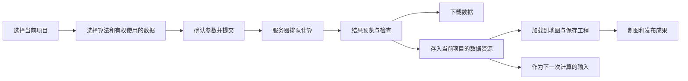
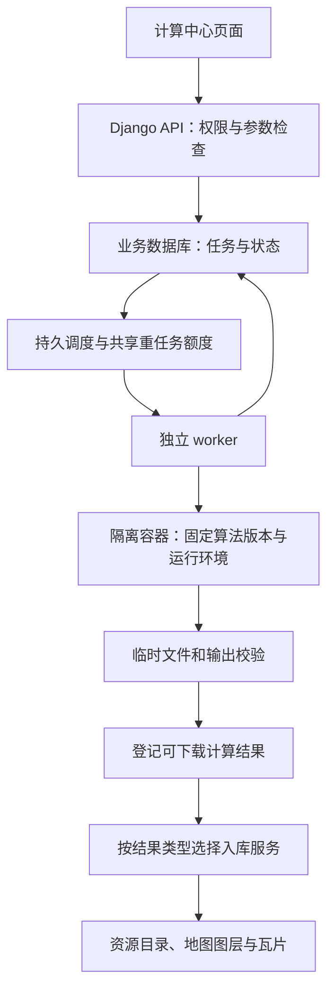
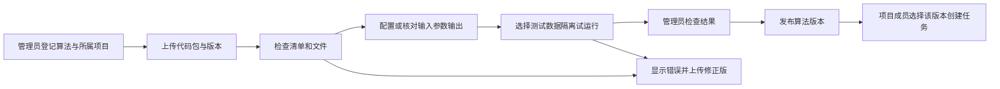

# 计算中心：需求分析与系统设计（审阅稿）

> 本文保留设计阶段内容；用户随后授权实施，2026-09-20 起 AutoDL 的实际计算执行方式改为本机 Python 子进程。功能边界和验收以 [本机进程模式记录](2026-09-20-native-compute-mode.md) 及 [实施与部署记录](2026-09-19-compute-deployment.md) 为准。

日期：2026-09-19。对象：当前时空智能服务平台。

**本稿的目标：建设可持续扩展的计算中心。管理员按照统一规范添加、配置、验证和发布各种算法；用户选择有权调用的算法和有权访问的数据，提交任务，完成后预览、下载、入库和继续分析。算法与数据一样作为资源管理。NDVI 仅为说明计算过程的示例，不限定平台功能或首期算法清单。**

最新设计以“通用计算框架 + 管理员可扩展算法库”为主线。算法接入、参数表单、输入检查、输出识别和版本管理均按统一规则工作；增加符合现有规范的新算法时，不需要改平台页面、增加专用业务接口或重新发布前端。新数据类型或新运行环境仍需适配，不能承诺任意代码上传后都能自动运行。

本文只提出设计，不表示功能已经上线。没有修改应用代码、数据库、现行权限或 OpenAPI。文中“建议”“首期规则”为本次待审方案；既有项目隔离规则继续有效。

## 1. 用户实际会怎样使用

例如，刘洋进入“管道院”项目，点击顶部“计算中心”：

1. 从算法库选择一个算法，例如栅格统计、缓冲区分析或表格分组汇总。
2. 平台按该算法要求，列出管道院项目内有权访问且类型匹配的数据；不必事先加载到地图图层。
3. 填写平台根据算法配置生成的参数，例如统计字段、缓冲距离、处理范围。
4. 查看检查结果：输入是否满足要求、参数是否有效、输出类型/大小、是否需要排队。
5. 填写任务名称，点击“提交计算”。
6. 页面显示排队、校验、计算、整理结果等阶段；关闭浏览器不影响已经提交的任务。
7. 完成后查看结果列表；按结果类型预览地图、表格或图件，下载文件或点击“存入数据资源”。
8. 入库后，该结果归属“管道院”。地理数据可加载到工作台、保存工程并制图，非地理数据可继续分析；合格结果可作为后续算法输入。

一次计算产生一条可追溯记录：谁在什么项目，用哪些版本的数据、哪些参数和算法版本，得到了哪些文件。



## 2. 模块定位和入口

### 2.1 顶部导航

将“最上面”理解为现有顶部主导航。建议顺序：**地理工作台 → 数据资源 → 计算中心 → 现有分析、成果等入口**。保留此前确定的“工作台第一、数据资源第二”和登录后进入工作台的规则。

计算中心内部设四个页签：

| 页签 | 用户能做什么 |
| --- | --- |
| 算法资源 | 按分类浏览和搜索已发布算法、查看输入输出与版本，选择算法新建任务；有维护权限者可进入管理 |
| 我的任务 | 查看当前项目内本人提交的任务，筛选状态，取消、重试、复制参数 |
| 计算结果 | 查看当前项目内本人任务的可用输出、下载、入库，以及已经入库的去向 |
| 使用说明 | 解释算法选择、数据条件、参数、项目归属、结果用途和常见错误 |

后台管理增加“算法分类”“算法资源”“算法版本”“运行环境”“计算任务管理”。有算法维护权限的管理员在获授权项目内接入算法；超管可管理所有项目。用户在计算中心使用已发布算法，无需进入后台。

数据资源详情增加“用于计算”按钮，自动带入数据和所属项目；任务详情增加“查看来源数据”“查看已入库数据”“加载到工作台”入口。

### 2.2 与现有分析、查询、制图的关系

| 现有能力 | 与计算中心的关系 |
| --- | --- |
| 数据资源 | 提供已登记输入；接收用户确认入库的计算结果 |
| 地理工作台 | 显示输入和输出；计算不依赖工作台是否加载图层 |
| 空间查询 | 继续只能选择已加载矢量来源；本次不修改其规则 |
| 非地理数据分析 | 首期保留现有入口和内容，未来可将耗时分析接入同一任务机制 |
| 在线制图 | 将计算产生的栅格/矢量等地理数据作为图层，制作地图成果 |
| 成果展示 | 接收明确发布的图件、报告等；计算成功本身不会自动发布 |

首期实现通用算法注册与执行机制，建议先提供 Python 包接入方式。管理员上传符合规范的算法实现，填写输入输出、参数、环境和使用说明，检查/试运行后发布。普通用户的算法贡献可保留“提交候选包”入口，由管理员确认后纳入算法库；普通科研用户不默认具有正式发布权。其他语言和执行方式通过后续运行适配器扩展，平台核心不能绑定 NDVI 或某个具体算法。

## 3. 选择数据和项目权限

### 3.1 一个任务只能属于一个项目

- 任务在创建时固定当前项目，输入、临时结果、入库数据和审计记录都携带同一个项目标签。
- 首期数据选择器只列出**当前项目内有权访问、且满足算法条件**的数据。即使用户具有多个项目标签，也不在一次任务中混用不同项目。
- 超管可以切换到任一项目发起任务，但一次任务仍只有一个项目归属。
- “公开”项目保持所有人可读取已开放数据的含义；提交计算仍要求登录和计算权限，匿名用户、共用游客账号不能消耗计算配额。
- 首期不直接把私有项目结果存到“公开”或其他项目。跨项目引用公开底数、跨项目复制结果可在后续单独设计，不在这里默认开放。

算法另有明确的公共工具使用规则：可选算法为“当前项目已发布算法 + 公开项目已发布算法”。公开算子可以在私有项目运行，输入和输出仍属于该私有项目，不授予算法作者读取这些数据的权限。其他私有项目的算法即使本人有访问权，也不直接在当前项目调用；先在正确项目操作。这项公共算子复用不改变数据选择的同项目规则。

这样，刘洋在“管道院”选择数据时，不会看到“核地院”的数据，也不会因为知道数据 ID 就能提交该数据的计算。

### 3.2 项目切换行为

未提交的表单切换项目时提示保存草稿或放弃，清空已选输入并重新检查权限。已提交任务继续在原项目执行；当前任务列表随顶部项目过滤。完成提醒带项目名称，点击后进入该项目任务；若权限已撤销，提示无权访问。

计算数据选择与空间查询的规则不同：**计算可选当前项目内未加载到地图的数据；空间查询仍只选已加载矢量来源。** 两个界面分别明确说明，避免混淆。

### 3.3 功能权限

继续使用 Django 权限与现有角色，不创建另一套账号/角色体系。建议新增 `compute.submit_task`、`compute.view_own_task`、`compute.cancel_own_task`、`compute.manage_tasks`；结果导出继续叠加现有数据导出权限，入库叠加现有上传/数据创建权限，正式发布叠加现有成果发布权限。

算法管理增加登记/上传、维护、下载源码包、试运行、发布和停用等独立功能权限，授予管理员或获授权维护者，详见第 16 节。科研用户默认使用算法、提交任务；如启用算法贡献，提交候选包不等于发布。此处不调整此前暂缓的新闻/科普编辑角色。

| 操作 | 建议默认范围 |
| --- | --- |
| 浏览算法说明 | 公开已发布算法所有人可读；私有项目算法需对应项目访问权 |
| 新建计算 | 科研用户和超管默认具备；其他角色由超管分配功能权限 |
| 查看个人任务、参数、日志和未入库结果 | 任务创建人且仍具有项目访问权；超管可管理 |
| 取消或重试 | 创建人且当前权限有效，或超管 |
| 下载数值结果 | 上述任务访问范围 + 数据导出权限；不能借计算绕过原有导出限制 |
| 存入数据资源 | 上述任务访问范围 + 上传/创建数据权限；只能当前任务项目 |
| 查看入库后的资源 | 沿用项目成员范围、资源启用状态和现有功能权限 |
| 发布图件/报告 | 沿用成果发布权限；发布时明确目标项目 |

“我的任务”是个人操作记录；结果入库后成为项目资源，项目内可见性不由创建者自行指定角色。公开项目中的计算草稿也不自动公开，避免半成品和调试日志出现在公共区域。

### 3.4 服务端检查时点

提交、开始执行、长任务分块检查、完成结果登记、下载、预览和入库均重新检查账号/项目/数据访问权。撤销成员资格后，排队任务取消，运行任务在安全边界停止并不发布结果；文件接口同步拒绝访问。任务被取消或权限失效后，迟到的计算进程不能重新登记成功结果。

## 4. 页面与操作流程

### 4.1 新建任务：四步表单

| 步骤 | 主要内容 |
| --- | --- |
| ① 选择算法 | 算法名称、用途分类、来源、作者、固定版本、输入要求和输出说明；仅正式可调用版本进入普通任务表单 |
| ② 选择数据 | 当前项目、名称搜索、算法所需的数据类型及元信息；按需显示字段/几何/坐标/波段条件，不满足条件时显示具体原因 |
| ③ 设置参数 | 自动生成数字、枚举、布尔、字段、波段、时间或范围等控件；展示默认值、单位、范围和帮助说明 |
| ④ 检查并提交 | 摘要列出项目、输入、范围、参数、输出大小估算、配额和结果保留时间；点击提交 |

数据不符合条件时给出具体原因，例如“缺少数值型人口字段”“该算法要求面数据，当前选择的是点数据”“没有识别到近红外波段”。检查来自算法声明和受控校验逻辑，不能在平台通用页面中写死某一个算法的条件。

轻量预检只读取元数据和权限，快速返回。全文件校验、输入固定、像元统计等耗时检查进入后台阶段；不让 HTTP 请求长时间等待，也不在提交前承诺精确运行时长。

### 4.2 任务列表与详情

列表列出：名称、算法、输入数据、所属项目、状态、当前阶段、进度、提交时间、耗时和操作。支持按状态、算法、关键词、时间分页筛选。

详情分为任务概览、输入/参数、执行进度、结果文件、运行说明五部分。用户看到的说明采用可行动语言；完整技术堆栈只给管理员，日志不暴露服务器路径和服务凭据。

完成提醒使用站内通知和任务列表状态。用户离线时保存未读提醒，下次登录可见；首期不新增邮件或外部消息发送。

### 4.3 结果页面

| 操作 | 结果 |
| --- | --- |
| 结果预览 | 按类型采用地图、表格或图像/报告查看器；空间预览复用服务端处理，不能把所有输出都当栅格 |
| 下载结果文件 | 下载算法声明并经校验的实际文件，如 GeoTIFF、GeoPackage、CSV 或报告 |
| 下载统计/说明 | CSV 和 JSON，记录统计值、参数、来源和处理方法 |
| 存入数据资源 | 按类型创建同项目栅格、矢量或表格资源；复用服务端结果，无需下载到电脑再上传 |
| 加载到地理工作台 | 已入库时直接加载；未入库时先引导完成入库，然后加载 |
| 复制任务 | 复制算法和参数进入新表单，重新验证当前输入和权限，生成新任务记录 |

初始页面默认不开启“计算后自动入库”。自动入库可作为后续用户可选项；即使加入，也不等同于自动发布成果。

## 5. 管理员添加算法的统一规则

### 5.1 算法库可以持续增加内容

平台提供算法分类与检索，不在代码中固定一份算法名称列表。管理员可以添加分类、维护显示顺序，按用途、数据类型、作者和项目检索算法；算法多时使用分页和筛选，不能一次加载所有版本或代码包。

| 算法方向 | 可接入的例子 | 常见输入与输出 |
| --- | --- | --- |
| 栅格处理 | 裁剪、重采样、栅格统计、重分类 | 栅格/范围 → 栅格或统计表 |
| 遥感计算 | NDVI 等指数、变化计算 | 指定波段或多时相影像 → 指数/变化栅格 |
| 矢量分析 | 缓冲区、叠加、空间连接、面积统计 | 点线面及参数 → 矢量/表格 |
| 表格计算 | 分组汇总、缺失值处理、相关分析 | 表格/字段 → 表格、图件或报告 |
| 时序处理 | 趋势统计、异常检测、时间聚合 | 含时间字段的数据 → 时序结果和统计 |
| 模型推理 | 已训练模型对授权数据推理 | 数据及模型权重 → 预测结果 |

这些是算法库的扩展方向，不代表此刻都已实现，也不预先限定只能接入这些算法。管理员根据实际需求分批增加；不同数据类型或 GPU 等运行条件需要对应适配能力。

### 5.2 每个算法必须登记的内容

| 规则 | 管理员填写/上传的内容 | 平台如何使用 |
| --- | --- | --- |
| 身份与版本 | 稳定标识、名称、版本、用途、分类、作者/来源、说明 | 分类检索和固定版本调用，名称不能代替算法 ID |
| 实现 | 符合规范的算法包与入口 | 从统一执行入口调用，不给每个算法另写 API |
| 输入 | 各输入名称、类型、必填性、数量，以及字段/几何/坐标/波段要求 | 筛选数据并在前后端检查；支持多个命名输入 |
| 参数 | 类型、单位、默认值、上下限、枚举、帮助、条件显示规则 | 自动生成表单和校验提示；默认值也保存进任务快照 |
| 输出 | 每项结果的类型、格式、必需性、显示名称、预览与入库方式 | 自动选择查看器和入库服务，支持多个结果 |
| 环境 | 平台支持的运行环境与依赖版本 | 固定执行镜像；不能让算法安装依赖到 Web 服务环境 |
| 资源 | 预计规模、CPU/内存/时限建议 | 在平台总配额内安排任务；包内声明不能扩大系统上限 |
| 可见范围 | 所属项目、启停状态、维护人 | 沿用项目权限；公开算法可供其他项目作为工具调用 |
| 验证 | 小样输入、预期输出/容差、异常用例和运行说明 | 发布前检查算法是否可调用、输出是否符合声明 |

### 5.3 管理员的操作步骤

**新增算法 → 上传规范包 → 核对输入/参数/输出 → 选择运行环境 → 试运行与查看验证结果 → 发布。**

管理员拿到已符合规范的算法包后，应能在后台完成上述流程。已有普通 Python 脚本若没有统一输入输出接口，需要算法提供者先做一次封装；平台不会自动理解任意脚本。平台提供栅格、矢量、表格三类模板和说明，降低封装成本。

后台表单可读取包内清单，也可由管理员在界面配置。发布时生成唯一规范化清单并校验，随后与该版本一起固定，避免界面配置和包内配置互相矛盾。

新算法发布后，用户前台自动出现该算法及参数表单。增加支持范围内的新算法，只增加算法资源/版本与包文件，不修改通用前端页面、业务路由或数据库表结构。

### 5.4 平台共性与算法差异

平台统一负责账号项目权限、数据选择、参数表单、排队、进度、取消、日志、文件管理、下载、入库和来源追溯。算法包负责自身数学/业务计算以及必要的专业校验。

参数间的依赖优先使用有限的声明规则，例如选择某种统计方式后才需要指定字段，不执行包内自带的前端 JavaScript。复杂专业校验通过隔离执行中的校验入口完成，不把上传包导入 Django 进程来生成表单。

输出按声明和实际文件共同判断。栅格、矢量、表格、图件和报告分别进入对应查看器；未知格式不能伪装为现有类型。增加全新数据类型、硬件要求或语言环境时，需要新增平台适配器，这类变更与日常添加算法区分管理。

### 5.5 初版必须证明扩展能力

至少选择栅格、矢量、表格三种不同类型的代表算法验证同一套流程，例如栅格统计、矢量缓冲、表格分组汇总。具体算法名单在开发准备时确定，NDVI 可作为其中一个示例，不作为平台边界。

关键验收：在通用框架部署后，由管理员通过后台再添加第 4 个符合现有规范的新算法，前端自动出现并能执行、下载和入库；全过程不修改应用源代码，不增加专用接口，不重新构建前端。

## 6. 任务执行和异常处理

### 6.1 状态

| 状态 | 用户看到的含义 | 可做操作 |
| --- | --- | --- |
| 草稿 | 参数尚未提交到计算队列 | 编辑、提交、删除草稿 |
| 排队中 | 已接受，等待计算资源 | 查看、取消 |
| 校验中 | 固定输入版本，检查文件、波段、网格和配额 | 查看、请求取消 |
| 运行中 | 分块计算和输出检查 | 查看阶段与进度、请求取消 |
| 正在取消 | 已收到停止请求，等待当前处理段退出 | 查看 |
| 已完成 | 数值结果及必要校验已完成，可下载 | 预览、下载、入库、复制任务 |
| 失败 | 输入、运行或输出校验失败 | 查看具体原因、修改后新建或重试 |
| 已取消 | 没有登记可用计算成果 | 复制任务 |
| 执行中断 | 工作进程异常退出，需恢复或重新执行 | 查看恢复状态/重试 |

预览生成、正式入库各有独立状态。数值结果已合格但预览失败时，任务显示“计算完成，预览生成失败”，仍能下载原始计算结果并重建预览。入库失败同样不要求重新计算。

结果“已过期/已入库”是文件生命周期状态，不回写计算任务为失败。过期后保留任务信息和入库去向。

### 6.2 用户操作的具体含义

- **取消**：排队时直接退出；运行时发出停止请求，在分块边界停止，必要时终止子进程树。确认进程停止后才显示已取消。
- **重试**：保留原失败记录，创建关联的新任务，不覆盖失败原因；重新验证权限、输入版本和配额。
- **再次提交相同按钮请求**：同一幂等键返回原任务，避免网络重试或双击创建重复计算。用户主动“再算一次”可创建新任务。
- **服务重启**：网页服务重启不终止独立计算进程；计算进程异常时通过心跳识别。首期重做整个受影响任务，不声称逐像元断点续算；确定性算法在权限和输入仍有效时可自动恢复一次，超出则显示中断。
- **删除任务**：终态任务可归档；运行任务先取消。清理任务临时结果不删除已经入库的数据，也不删除审计记录。

权限撤销、输入改变、参数错误不自动反复重试。磁盘满应立即停止新接收和输出登记，并显示可理解的处理提示。

### 6.3 进度和容量

校验、计算、输出整理分阶段展示；已知总块数时按处理块数给进度，不使用与实际处理脱节的动画百分比。排队只显示状态和大致顺序，缺乏历史基线时不显示精确剩余秒数。

建议初始配置：全平台重型任务同时运行 1 个，每用户最多 1 个运行任务、3 个排队任务，平台排队上限 20；单任务最长 30 分钟、总输入上限 1 GiB、输出上限 1 亿像元。**这些是拟定起点，须按本机内存、磁盘和测试影像实测调整，不是现有硬件性能承诺。**

导入、预处理、批量瓦片生成和计算必须共享全局重任务额度，不能每个模块各开一个不受控线程导致总负载翻倍。同步限制 CPU 线程、内存、临时磁盘和输出大小；计算前预留空间，过程中继续监测。按项目/用户轮转，同一用户的批量任务不能长期占满队列。

## 7. 结果下载、入库和发布

### 7.1 四种状态要在界面上说清楚

| 结果所处位置 | 对用户意味着什么 |
| --- | --- |
| 任务结果 | 已算好、暂时保存；创建人和超管可在权限范围内访问 |
| 下载到电脑 | 拿到数值文件，平台任务不自动入库或发布 |
| 存入数据资源 | 成为所属项目的正式数据，可供有权成员加载、查询元信息和后续处理 |
| 正式成果 | 通过制图/报告等生成并发布，在现有成果入口展示 |

每项结果应下载真实计算文件。例如 NDVI 输出数值 TIFF，预览 PNG 单独提供；矢量算法输出实际几何文件，表格算法输出数据表。TIFF 入库走栅格数据链路，不能强塞进仅支持 PNG/JPG/PDF/CSV/XLSX 的现有成果上传接口。

### 7.2 一键入库

用户填写资源名称、说明、来源说明；项目固定为任务项目。平台按实际输出选择地理/非地理分类和资源类型，不固定为连续型栅格。表单显示“入库后本项目有权用户可访问”；公开项目显示“入库后所有人可读取”，由这次明确操作确认。

栅格结果的服务端流程示例：检查输出未过期且校验通过 → 锁定输出防止清理 → 复制/登记到正式科研存储 → 创建 RasterDataset、RasterBand、DataResource、MapLayer → 调用已有预处理和瓦片机制 → 成功后返回资源 ID。

上面是 NDVI 的栅格入库流程。用户算法输出另按类型适配：GeoPackage 矢量走已有矢量校验与导入；CSV 表格走已有字段/类型校验与表格导入，有坐标的表格由用户明确选择坐标字段后转地理数据，无坐标表格存为非地理数据。PNG/PDF 可下载，正式发布走现有成果管理权限。未知格式仅在平台明确支持后开放，不能只凭算法清单写了“可入库”就跳过校验。

入库期间显示独立进度。在正式数据准备完成前不把半成品标成可用。使用“输出 ID + 目标项目”唯一约束和幂等键，重复点击返回原入库记录；失败可重试，回收无引用文件。

默认保存数值文件和计算出处，不自动加入所有人的工作台，也不自动修改已有地图工程。本人点击“加载到工作台”后再加载，需要长期保存则按现有流程保存工程。

### 7.3 保留和清理

建议：未入库结果保留 7 天，界面显示确切到期时间；任务摘要和参数保留 90 天，操作审计沿用平台策略。允许有权限用户在配额内延长结果保留期。

已入库文件转为正式资源，不受任务 7 天清理影响；任务清理只删除它自己的临时副本。正在下载、入库或被运行任务固定引用的文件暂不清理。后台每日清理必须作为部署中的明确步骤配置和验证，不能只有清理函数就宣称已自动运行。

入库后的数据独立保留来源记录。删除原输入不级联删除已经入库的派生数据，但应标明“源数据已不可用”；重算必须重新检查来源。计算产物移往其他项目或改为公开不在首期提供。

## 8. 当前系统能复用什么，需要补什么

本轮只读检查发现，实际库目前有 **2 份矢量资源，没有已登记 RasterDataset**。验收需要另外准备栅格、矢量和表格样例，验证多种算法使用同一套接口和流程；若使用 NDVI 作为样例，还需真实红光/近红外影像。

| 当前实现与证据 | 设计处理 |
| --- | --- |
| [栅格模型](../backend/apps/raster/models.py)：已有源路径、校验值、源/处理元数据、RasterBand | 复用输入登记，补标准化的波段语义、scale/offset、采集时间和适用算法检查 |
| [后台任务](../backend/apps/raster/services/jobs.py)：进程内线程队列，单运行、4 个等待；重启会把遗留任务记为失败 | 不能直接当可靠计算中心。抽出可持久领取的调度，独立 worker 执行；保留旧接口的对接层 |
| [栅格入库](../backend/apps/raster/services/catalog_sync.py)：已有 RasterDataset 到资源和图层的登记 | 提炼可复用入库服务，计算结果走内部文件入口，避免 HTTP 下载再上传 |
| [文件路径](../backend/apps/core/storage.py)：TOML 根路径与项目目录 | 新目录通过现有安全路径函数解析，禁止客户端传绝对文件路径 |
| [成果文件](../backend/apps/catalog/results.py)：不支持 TIFF | 数值 TIFF 归栅格数据；图件/报告继续沿用成果系统 |
| [顶部导航](../frontend/src/components/WorkspaceHeader.tsx)与[路由](../frontend/src/App.tsx) | 增加计算中心主入口及后台任务管理入口 |
| [当前规则](current-platform-rules.md)：一人多项目、单项目操作、公开标签、功能权限 | 新任务和输出遵守同一规则，不引入“全部可访问”入口 |

当前 NDVI 相关的符号化模板仅表示显示样式，不能视为已经具有 NDVI 数值计算能力。

## 9. 后端执行架构

建议新增 `backend/apps/compute/`，负责算法资源与版本、参数检查、计算任务、执行记录、输出及入库请求。算法使用与现有 Python/GDAL/Rasterio 等依赖对应的受控运行镜像，按算法声明选择；管理员添加的代码也进入第 18 节定义的隔离环境。平台核心不内置 NDVI 专用执行分支。



首期建议单机控制服务、数据库持久任务表、一个独立 worker，加 Linux 容器执行层。当前 Windows 环境可评估 WSL2/受管理的 Linux 容器运行环境，或连接独立 Linux 执行机；硬件与容器可用性尚未核实，这是执行用户代码前的必需条件。SQLite 暂保留：短事务领取、条件更新、节流心跳，不把大日志和逐块结果反复写数据库。多控制进程/数据库争用明显时，再评估 PostgreSQL 与专用队列。

调度从数据库领取任务，使用执行编号、租约和心跳记录。只有当前执行编号有权登记输出；过期进程即使晚到，也不能覆盖新任务状态。调度数据库是事实来源，不用内存队列证明任务一定会执行。

旧栅格导入/渲染/导出任务逐个接入共享执行额度，旧接口响应保持兼容；历史 RasterProcessingJob 保留，不要求首期改写所有旧记录。API 数据表写入和队列投递应在提交后可恢复，避免“记录已创建但没入队”或重复投递导致重复入库。

算法注册采用明确的名称、版本、输入类型、参数结构、输出结构和入口函数。内置及用户算法都按固定版本调用；用户算法需通过包检查、试运行和发布流程。任务参数由平台构造，不拼进 shell；不提供任意服务器路径、任意网址或宿主机命令参数。源码检查不能证明算法无害，运行时隔离必须一直生效。

### 输入固定与可靠输出

任务记录数据资源 ID、源数据 ID、文件校验值和参数快照。执行前固定所用文件版本：平台已不可变存储的文件可持有引用；否则复制到受控输入区并计算校验值。大文件复制和校验在后台执行并计入配额。不能一边允许源文件被覆盖，一边声称任务可复现。

任务结束可清理临时输入副本；如果原始输入版本随后被删除，记录仍可追溯，但不能承诺完全重算。详情明确显示“原输入版本可用/不可用”；正式长期复现实验可将输入版本作为正式资源保留。

执行中禁止删除被固定引用的正式文件。计算结束校验 TIFF 可读性、尺寸、坐标、掩膜和统计，再将临时文件原子转为完整输出。数据库和文件系统不能共用一个事务，因此采用明确的“准备输出→登记输出→完成”流程；崩溃后检查可恢复记录与无主临时文件。

## 10. 数据模型建议

不推翻现有业务库，新增计算相关表，关联现有 User、Project、DataResource、RasterDataset。

| 实体 | 核心字段与用途 |
| --- | --- |
| AlgorithmResource | 项目、所有者、名称、用途分类、来源（内置/用户）、说明、作者/许可、当前发布版本、启停状态、revision |
| AlgorithmVersion | 算法资源、唯一版本号、不可变代码包/清单校验值、参数结构、输入输出约束、运行环境镜像摘要、验证/试运行/审核状态、发布时间 |
| AlgorithmValidation | 版本、包检查结果、受控试运行任务、输出检查、审核人/结论和失败原因 |
| ComputeTask | UUID、project_tag、owner、name、algorithm_key/version、参数快照、status/stage/progress、priority、幂等键、created/queued/started/finished、取消标志、error_code、revision、重试来源 |
| ComputeInput | task、由清单定义的输入名称、资源 ID/类型、选择字段或波段、文件版本/校验值、元信息快照和固定文件引用；不固定为 red/nir 等字段 |
| ComputeAttempt | task、attempt_number、worker_id、租约/心跳、开始结束、资源用量、退出原因；区分任务和一次实际执行 |
| ComputeOutput | task、输出名称/类型、相对路径、MIME、大小、校验值、CRS/范围/分辨率/NoData、统计、preview_status、expires_at |
| ComputeImport | output、project、status、资源/栅格/图层 ID、重试信息和完成时间；保证一个输出不被重复入库 |
| RuntimeLease | 全局重任务槽位、持有人、执行编号和过期时间；防止计算与旧栅格后台任务重复占用额度 |

项目约束贯穿所有关联表：输入和输出项目必须与任务一致；普通 API 不允许覆盖所属项目。任务日志采用受控文件或按阶段限量事件，摘要入库，避免 SQLite 持续大字段写入。

ComputeTask 必须关联确切 AlgorithmVersion，同时保存代码包与运行镜像摘要。该版本的算法项目必须等于任务项目，或为已发布的公开算法；这是算法关联校验的唯一首期例外。不能只存算法名称或 `latest`。

## 11. 存储与备份

| 内容 | 建议位置 | 管理方式 |
| --- | --- | --- |
| 算法代码包、版本清单 | `app_data/projects/<project>/algorithms/<algorithm>/<version>/` | 不可变版本，平台备份覆盖；有任务或正式资源引用时禁止物理删除 |
| 参数、状态、引用 | 现有业务数据库 | 随平台备份 |
| 执行临时目录、固定输入副本 | `app_data/cache/compute/<project>/<task>/<attempt>/` | 单任务隔离，不纳入持久备份，终态后清理 |
| 已完成、未入库输出 | `app_data/projects/<project>/compute/outputs/<task>/` | 受控文件接口，7 天到期；平台备份已覆盖 projects |
| 已入库数值文件 | 现有 `research_path(...)` 项目规则下的栅格原始/派生目录 | 正式科研存储，科研备份覆盖 |
| 显示副本与瓦片 | 已有栅格预处理、缓存目录 | 可重建；不覆盖科学数值文件 |

以上均为相对 TOML 数据根目录的示意，不硬编码 D 盘路径。公开项目仍遵循当前 research_path 的原目录约定，不能人为增加一套不兼容路径。

备份恢复要覆盖任务、结果引用和已入库资源。恢复后不自动认定旧“运行中”任务仍在执行；重新核对 worker/租约，标为可恢复或中断。已过期临时文件缺失应明确显示过期，不伪装成仍可下载。

## 12. 拟议 API（方案，不是已上线契约）

开发时先写入 `docs/openapi.yaml`、更新开发指南和 Mock、生成类型，再实现后端和前端。本稿不提前把未实现接口加入生产契约。

| 接口 | 用途 |
| --- | --- |
| GET/POST `/api/compute/algorithms/` | 当前项目和公开算法检索；有维护权限的管理员在显式项目注册算法资源 |
| GET/PATCH `/api/compute/algorithms/{id}/` | 算法详情与元数据；更新要求 revision，不能覆盖已发布代码 |
| POST `/api/compute/algorithms/{id}/versions/` | 上传代码包并创建新版本；返回校验任务 |
| GET `/api/compute/algorithm-versions/{id}/` | 版本、验证、输入输出与运行环境信息 |
| POST `/api/compute/algorithm-versions/{id}/trial/` | 创建受控试运行任务，仅算法维护者/获授权管理员操作 |
| POST `/api/compute/algorithm-versions/{id}/review/` | 普通贡献者提交候选版本；管理员可直接完成验证后发布 |
| POST `/api/compute/algorithm-versions/{id}/publish/` | 有发布权限的管理员发布指定版本，检查最新验证与运行环境 |
| POST `/api/compute/algorithm-versions/{id}/disable/` | 停用版本或管理员紧急冻结 |
| GET `/api/compute/algorithm-versions/{id}/package/` | 检查项目及源码下载权限后返回代码包 |
| GET `/api/compute/inputs/?algorithmVersionId=...&inputName=...&q=...` | 当前项目有权使用的数据摘要、匹配状态与不可选原因，分页 |
| POST `/api/compute/validate/` | 轻量检查；返回错误、提醒、估算和规范化参数摘要 |
| POST `/api/compute/tasks/` | 显式项目头与幂等键，创建任务，返回 202 和任务 ID |
| GET `/api/compute/tasks/` | 当前项目“我的任务”摘要分页，不夹带完整日志 |
| GET `/api/compute/tasks/{id}/` | 状态、输入参数、输出及可执行操作 |
| POST `/api/compute/tasks/{id}/cancel/` | 发起取消，返回最新状态 |
| POST `/api/compute/tasks/{id}/retry/` | 验权后创建关联新任务 |
| GET `/api/compute/outputs/` | 当前项目本人可读结果摘要分页 |
| GET `/api/compute/outputs/{id}/download/` | 受控下载，明确数值文件/说明文件，不返回服务器路径 |
| GET `/api/compute/outputs/{id}/tiles/{z}/{x}/{y}.png` | 临时结果预览，复用服务端渲染与权限检查 |
| POST `/api/compute/outputs/{id}/imports/` | 幂等入库，202 返回入库记录及进度入口 |
| GET `/api/compute/imports/{id}/` | 独立查询入库状态、资源 ID 和失败原因 |
| GET `/api/admin/compute/tasks/` | 管理员任务检索；其他暂停队列、停止任务等动作定义独立权限 |

错误继续采用 JSON detail，并增加稳定 errorCode 与字段信息：未登录 401、功能权限不足 403、不可见对象 404、参数错误 400、状态/版本冲突 409、超大请求 413、配额/队列限额 429。预检结果不能代替真正执行前的权限检查。

前端首期用 2–5 秒自适应轮询，页面隐藏后降低频率，任务终态停止轮询。旧项目/旧任务请求取消或按代次丢弃，避免再次出现切换后旧响应覆盖。SSE 可后续增加。

## 13. 开发批次与交付门槛

| 批次 | 交付内容 | 可以验收的结果 |
| --- | --- | --- |
| C1 通用规范与多类样例 | 算法清单/SDK、栅格/矢量/表格输入输出适配、三类参考包及数值验证 | 不同算法使用同一接口与数据选择机制，专业字段不写死在平台核心 |
| C2 算法资源与任务基础 | 契约/模型、算法上传/版本/校验、持久排队、共享执行额度、独立 worker 与容器隔离、取消/恢复 | 代码包可登记和隔离试跑，任务不因网页重启丢失；隔离未就绪时拒绝执行 |
| C3 管理接入与用户使用 | 顶部入口、后台算法分类/注册/维护、试运行/发布、动态计算表单、列表/详情和通知 | 管理员接入新算法后，前台自动可用，不重新开发页面 |
| C4 结果再利用 | 预览/下载、统计与来源说明、栅格/矢量/表格同项目幂等入库、加载工作台 | 完成“计算→下载/入库→地图→工程/制图”全链路，非地理表格进入数据资源 |
| C5 管理与运维 | 管理页、配额、磁盘/进程限制、定期清理、备份恢复、启动脚本 | 计算压力不会绕开限额，异常和空间不足有明确反馈 |
| C6 扩展性与回归验收 | 管理员接入额外新算法、多数据类型、精度、权限、并发/故障、大文件、说明 | 三类算法端到端通过；再添加新算法无需修改平台源代码 |

交付顺序按上述依赖推进。首期交付通用算法库、管理员标准接入、动态表单、版本管理和完整计算/结果流程，并用多种代表算法验证。算法内容可以在框架上线后继续增加，不把首期完成与某一个固定算法绑定。

后续工作分为两条线：管理员持续补充、分类和升级算法；平台开发按需求增加运行环境、数据适配器、批量调度或工作流能力。使用现有规范的算法只走接入流程，不为它重新安排一次平台功能开发。

暂不包含：宿主机任意命令执行、用户自带镜像、任意联网依赖安装、可视化多步骤工作流、GPU 深度学习训练、多机集群、跨项目拼接数据计算。用户上传算法在已支持的 Python 运行环境中执行；算法扩展和基础设施扩容分别评估。

本稿以交付批次列计划，不虚报固定人力或日历工期；C1 小样和代表性影像实测后，以实际运行、存储和失败恢复成本细化工期。

## 14. 验收清单

| 维度 | 必须通过的场景 |
| --- | --- |
| 数值 | 每个代表算法有已知答案与容差；栅格统计、缓冲距离/坐标单位、表格分组汇总分别验证；NDVI 如被选用则按附录示例验证 |
| 空间 | 按各算法声明校验 CRS、网格、几何和范围；重投影等算法可以改变坐标，必须记录转换，不能全局要求输出与输入相同 |
| 数据选择 | 当前项目内未加载到地图的合格数据可选；类型/字段/波段不匹配有具体原因；无权资源直接改 ID 也不能执行 |
| 权限 | 公开/私有项目、刘洋/超管/匿名对照；排队和运行中撤权；下载/预览/入库各检查；禁止结果跨项目搬运 |
| 状态 | 关闭浏览器、刷新页面、取消、重复提交、程序重启、旧进程迟到均不能伪报成功或重复出图 |
| 入库 | 重复点击只建一份资源；入库失败可以重试，原计算结果可下载；任务清理不删正式资源 |
| 故障 | 磁盘满、文件缺失/被改、损坏 TIFF、子进程超时、worker 崩溃、队列满分别有具体错误 |
| 资源 | 全局同时运行数受限；代表性大影像采用分块处理；记录峰值内存、磁盘与耗时，不用小图结果承诺大图性能 |
| 文件 | 栅格/矢量/表格分别能在独立工具中读取并验证；实际输出符合声明，预览不改变下载数据；备份恢复引用完整 |
| 现有功能 | 地图、上传、栅格渲染、项目隔离、工程、制图、内容、退出和已有测试不回退 |
| 算法管理 | 注册、上传、试运行、审核、发布、停用、新版本和源码下载权限；旧任务固定原版本，不能被新包覆盖 |
| 扩展能力 | 管理员通过后台添加第 4 个符合既有规范的算法，自动生成表单、调用、预览和入库，不修改核心代码或生成专用接口 |
| 代码隔离 | 越界文件/其他任务访问、网络访问、子进程膨胀、内存耗尽、超时、压缩包穿越、输出伪造分别被限制并记录 |

验收样例至少包括栅格、点线面矢量、数值/类别/日期表格，覆盖多输入、多输出、可选参数、异常输入和较大数据。各代表算法再补自身专业样例。性能基线注明数据规模、格式、硬件和环境，不用固定“几秒出结果”作为未测承诺。

## 15. 建议本轮确定的产品选择

| 事项 | 本稿推荐 |
| --- | --- |
| 名称与位置 | 顶部“计算中心”，放在数据资源后 |
| 首期重点 | 通用计算框架 + 管理员算法接入；以栅格、矢量、表格多类算法验收，NDVI 仅为可选示例 |
| 数据范围 | 当前项目内所有有权使用的合格数据，不要求地图已加载 |
| 项目归属 | 任务及入库结果固定同一项目，首期不跨项目 |
| 提交权限 | 科研用户/超管默认开放，其他角色按现有权限管理分配 |
| 结果处理 | 先形成个人任务结果，用户选择下载或入库，不自动公开 |
| 输出 | 由算法声明栅格、矢量、表格、图件/报告等类型，平台统一校验、预览、下载及入库 |
| 任务执行 | 独立 worker、Linux 容器隔离、持久任务状态、全平台共享重任务额度 |
| 保存期限 | 未入库结果默认 7 天，正式入库后按资源长期保存 |
| 算法管理 | 管理员按规则添加和维护，算法登记、源码下载、调用和发布分别控制；可选用户贡献草稿 |
| 算法发布 | 自动检查 + 隔离试运行 + 有权限管理员发布；不要求必须由第二名管理员再审核 |
| 扩展方式 | 标准包 + 配置接入新算法；新增语言、环境或数据类型通过平台适配器扩展 |

这些推荐项已经构成一套可直接拆分开发的首期方案；用户可以按本表修改规则，其余细节随之统一调整。

## 16. 算法像数据一样管理

### 16.1 算法与算子的对应关系

对用户统一称“算法资源”：例如“NDVI 计算”“地块面积统计”“某模型推理”。一个算法资源可以有多个版本。

算法包提供计算实现；管理员为它登记输入、参数、输出和运行环境，验证并发布后，该版本成为可调用的“算子”。算法作者和平台管理员可以是不同的人：作者准备实现，管理员负责接入和发布，用户通过表单调用。

“像数据一样管理”落实为以下能力：

| 数据已有的操作 | 对应算法能力 |
| --- | --- |
| 上传、填写元信息 | 注册算法名称、用途、作者、项目，上传代码包 |
| 分类、搜索和详情 | 遥感指数、栅格处理、矢量分析、表格统计、模型推理等分类；说明、示例和参数查看 |
| 项目标签 | 算法资源固定所属项目，发布和下载检查项目权限 |
| 启用/停用 | 控制该算法或版本是否允许新任务调用 |
| 下载 | 有源码下载权限时下载指定版本的完整算法包及说明 |
| 使用数据 | 点击“使用此版本”，自动生成任务表单并筛选适用输入 |
| 数据来源 | 保存算法作者、来源、许可说明、版本、依赖和验证记录 |
| 历史和修改 | 元信息可修订；代码升级必须上传新版本，保留旧版本 |
| 删除 | 无引用的草稿可删除；已被任务/正式资源引用的版本归档保留 |

算法采用独立的 AlgorithmResource 模型和列表，不将 ZIP 算法包分类成“非地理数据”。数据分类继续只有地理/非地理；算法按用途分类。统一顶部检索可增加“数据 / 算法 / 工程 / 成果”类型筛选。

### 16.2 项目与作者权限

例如，管理员在“管道院”添加“矢量缓冲分析”：未发布草稿由获授权维护者及超管管理；发布后刘洋等有权成员可查看说明、使用算子，具备源码下载权限者可下载代码包；核地院无权用户不可访问。

若算法登记在“公开”，**发布后**说明对所有人可见，有计算权限的用户可在自己的当前项目内调用。算法作者或仅有算法维护权的管理员不会因此看到别人的任务、输入、日志和输出；超管的任务管理权限另行检查。算法使用量可以提供汇总数字。

算法和数据一样，在注册时显式选择所属项目，初始可选“公开”；表单明显说明公开发布范围。算法有已发布版本/任务引用后，禁止直接修改项目标签。首期跨项目另建副本需要显式授权和独立登记，不提供后台偷偷改标签的捷径。

管理员具备显式授予的算法登记、上传、维护、试运行和发布权限；超管默认拥有全部管理权限。普通科研用户默认使用算法、提交计算任务。保留此前提出的用户贡献能力：可授权用户提交候选包及试运行，由管理员决定是否纳入正式算法库；它不是日常算法添加的唯一途径，也不默认授予所有用户发布权。

同项目调用者通常不能修改别人的算法。作者变更由超管执行并记录审计；元信息编辑使用 revision 防止相互覆盖。

## 17. 注册、上传与算子包规范

### 17.1 注册流程



算法注册表分为基本信息、输入数据、计算参数、输出结果、运行环境、示例与说明六部分。平台提供栅格、矢量、表格的最小模板与完整示例；管理员接收符合规范的包即可配置接入。算法作者可据模板封装已有实现，NDVI 只是可选示例之一。

首期文件形式建议 ZIP，包内至少包括 `operator.yaml`、`main.py`、`README.md`。可携带算法内部 Python 模块和小型测试说明；测试影像从平台已授权的数据中选择，不默认把大幅科研影像塞进代码包。

大型模型权重作为另一个具有项目权限的数据输入管理；普通算法代码包默认不承担大模型文件仓库功能。

### 17.2 清单示例

以下仅为拟议规范示例，不是已经实现的配置文件：

```yaml
apiVersion: geomanager/operator-v1
name: vector-buffer
version: 1.0.0
displayName: 矢量缓冲区
runtime: python-geospatial-v1
entrypoint: main.py
inputs:
  features:
    kind: vector
    required: true
    crsUnit: metre
parameters:
  distance:
    type: number
    exclusiveMinimum: 0
    default: 100
    unit: m
    title: 缓冲距离
outputs:
  buffer:
    kind: vector
    format: GeoPackage
    required: true
```

项目、所有者、上传者、实际代码校验值由服务端确认，不信任包内自行声明的值。运行环境选择最终锁定到镜像摘要，不能只用一个会变的名字。

该示例要求适合研究范围的米制投影坐标，不将经纬度的“度”直接当米。平台根据清单生成距离输入框和数据筛选；具体投影适用性由算法检查，不在通用任务页面写死缓冲算法逻辑。

参数类型首期支持：整数、小数、文本、布尔、枚举、字段选择、波段选择、空间范围。数据输入支持栅格、矢量和表格，由平台把已登记资源整理为标准文件；每种算法只声明自己需要的类型。通用接入规则遵循第 5 节；附录 A 只提供 NDVI 的专业计算示例。

一个算法可以接收多个命名输入并返回多个输出；每个数据输入都进行项目检查。表格字段、波段、范围等选择项从实际授权输入产生，不能提交任意本地路径。

### 17.3 输入输出约定

平台提供简短 SDK：读取输入路径与参数、输出文件登记、上报进度、写用户可读日志。第一版以固定入口函数（例如 `run(context)`）为主，由平台 runner 调用；用户无需编写 Web API。

执行时算法只看到容器内部的任务清单：选定数据的只读路径、参数、可写输出目录。不会收到 Django 会话、数据库连接、对象存储长期密钥或服务器真实数据根路径。

矢量输入从指定资源/图层导出为只含该输入的 GeoPackage；表格按指定资源导出为 UTF-8 CSV/明确格式。不能把存有多个资源的整份共用 GeoPackage 或 SQLite 库挂给算法，让它顺带读到其他表。

输出文件必须位于该任务输出目录，并与声明匹配。平台独立检查实际格式、坐标、大小和必要字段；算法打印“成功”或自行上报 100% 不能替代输出校验。进度日志有长度和频率限制，前端按纯文本显示。

### 17.4 上传检查与试运行

上传检查包括：大小、文件数、解压比例、路径穿越、绝对路径、符号链接、入口存在、清单字段、参数类型、输出声明及运行环境支持。建议代码包初始上限 50 MiB、解压后 500 MiB、最多 5,000 文件，允许平台按实测调整。清单采用安全解析，不执行上传包中的安装脚本。

首期用户选择平台预置环境，不在任务中执行在线 `pip install`。环境列表展示 Python/GDAL/Rasterio/NumPy 等版本；缺少依赖时显示具体原因，由管理员维护新的受控环境版本。用户任意上传 wheel/系统动态库或 Dockerfile 后直接构建执行暂不开放。

试运行也消耗计算配额、记录任务，并使用正式隔离机制；“测试模式”不会放宽文件或网络权限。作者选择小型有权数据，检查参数表单、日志、预览、输出是否匹配声明。系统报告格式/性能是否合格，算法科学正确性仍通过已知数值样例和审核判断。

## 18. 接入算法的隔离执行

上传算法意味着执行他人提供的代码。当前平台的 Python 子进程超时机制可以复用部分进程管理逻辑，但**只限制运行时间不足以隔离服务器文件、账号和其他项目数据**。

建议首期采用以下固定运行规则：

| 边界 | 设计要求 |
| --- | --- |
| 运行位置 | Linux 容器；平台 worker 作为控制端，用户代码在独立容器中运行 |
| 身份 | 非 root 用户、禁用特权模式、移除额外 capabilities、限制系统调用；不挂宿主机管理套接字 |
| 文件 | 算法包只读，选定输入只读，输出/临时目录仅本任务可写；不挂平台代码根、业务库、科研根和其他任务目录 |
| 网络 | 默认完全禁止网络；外部数据由用户先按平台上传流程入库，算法不能自行请求互联网或内网接口 |
| 资源 | CPU、内存、进程数、运行时间、临时空间、输出总量均限额；磁盘不能只依赖定时检查，执行卷需具备可落实的容量限制 |
| 凭据 | 容器中无平台账号、数据库口令、Mapbox Key、云存储长期凭据或 Docker 控制权 |
| 结束 | 停止整个任务进程组/容器；校验输出后移交结果；清理任务执行区 |

容器边界由平台维护，算法包不能请求提升权限、扩大挂载目录或自行开放网络。静态代码检查、人工审核和容器隔离分别发挥作用，不能互相替代。

由于当前主机运行 Windows，C2 需要先验证 WSL2/容器能力、文件传输速度、磁盘限额和停止进程行为。若采用独立 Linux 执行机，控制端向其传输明确授权的输入副本与短期任务指令；用户容器仍拿不到控制端凭据。首期只需一个受管理的执行节点，不必同时建设多机集群。

**隔离环境未安装、失效或健康检查失败时，平台可以继续登记算法，但不能放行接入算法的试运行和正式计算。** 界面明确显示“执行环境未就绪”，不能临时改为在 Django 所在宿主机直接执行。

算法公开复用时尤其遵守该规则：公开算法作者不接收调用者输入；无网络和受限挂载阻止其通过常见途径读取其他任务或发走当前任务数据。仍需持续维护容器和解析库，不宣称源码扫描能够证明任意代码绝对安全。

## 19. 版本、发布、停用与删除

### 19.1 一次发布固定一个版本

管理员添加的版本依次经历“已上传 → 检查中 → 可试运行 → 试运行通过 → 管理员发布”。若启用普通用户贡献，则在发布前增加“待管理员确认”；失败和退回保留原因，已发布版本可停用或归档。

每个版本均需包检查、至少一次隔离试运行和数值样例验证。有发布权限的管理员检查结果后可以直接发布，不强制要求第二名管理员重复审批。发布页面展示源码、环境、输入输出变化和测试证据；普通贡献者不能跳过管理员直接公开算法。

普通任务只能选择已发布且未停用的版本。编辑算法说明不改变代码；修改代码、依赖、输入输出结构或数值参数语义都必须创建新版本。

算法页面可以推荐最新稳定版本，但创建任务时立即解析并固定具体版本、代码包校验值、清单和镜像摘要。版本升级后，旧任务和旧成果仍指向原版本，用户可以查看它们当时怎么计算。

### 19.2 升级和兼容性

| 变化 | 处理方式 |
| --- | --- |
| 修正文案 | 更新元信息 revision，记录修改人 |
| 修算法代码但参数不变 | 发布新版本，重新检查和试运行 |
| 参数/输入/输出发生变化 | 发布新版本并说明差异；旧任务复制时使用原规范或引导转换 |
| 运行环境升级 | 新环境摘要视为新执行版本重新验证，不能悄悄替换旧镜像 |
| 数据或包不再可用 | 保留来源信息，重算时明确阻止或要求选新版本 |

### 19.3 停用与冻结

普通停用阻止新提交和未开始任务领取，未开始任务显示原因并结束；已运行任务默认允许完成，结果仍按项目访问。管理员发现异常代码时使用“紧急冻结”，立即阻止新任务并取消相关运行任务，冻结输出对外访问，记录原因和受影响范围。

停用算法不会自动删除已经正常入库的数据。若确认某版本有科学计算错误，提供按算法版本检索派生资源的能力，标记“需复核”，由有权限人员决定重新计算或下架，不无声改写历史结果。

### 19.4 删除

无引用的算法草稿/失败上传包可由有权所有者删除。已发布或被任务、正式数据引用的版本使用归档；代码包、环境摘要和出处随引用保留，防止删除算法后所有数据失去计算依据。

归档任务可以压缩明细，但正式数据引用的最小来源记录不得随 90 天任务列表保留期一起删除。算法源码和环境清单随平台备份，正式派生数据随科研备份；恢复演练同时核对两类引用。

## 20. 管理员持续添加算法的验收流程

1. 管理员分别添加栅格统计、矢量缓冲、表格分组汇总等代表算法，登记项目、版本、输入参数输出和运行环境。
2. 平台根据每个算法的清单生成不同的使用表单，自动筛选相应的栅格、矢量或表格资源。
3. 管理员完成已知答案测试和隔离试运行后发布；项目成员可见范围正确，普通用户不能越权维护或发布。
4. 刘洋选择管道院内的合格数据，调用这些算法，分别预览、下载并存入相应类型的数据资源。
5. 框架保持运行，管理员再接入此前未出现在平台源码中的第 4 个合规算法；不改页面、不新增算法专用接口、不改数据表结构、不重新构建前端，该算法即可调用。
6. 管理员发布某算法 1.1.0，旧任务仍固定使用 1.0.0；停用某一版本不影响其他算法或无关项目任务。
7. 普通用户若被授权贡献算法，提交候选包后仍需管理员检查发布；管理员可以直接接入团队或外部作者提供的规范包。
8. 公开算法在私有项目运行时，数据和结果仍属于私有项目，算法作者不自动获得任务数据；异常算法受到资源和文件网络边界限制。

数据资源、算法资源和计算任务分别管理；算法库可以增长，任务流程、权限规则和结果利用方式保持统一。

## 附录 A：NDVI 接入示例（不限定平台功能或首期算法清单）

### A.1 算法和输出

公式：`NDVI = (近红外反射率 − 红光反射率) / (近红外反射率 + 红光反射率)`。

例如，近红外反射率为 0.60、红光反射率为 0.20，结果为 0.50。输出为单波段 Float32 栅格，保留地理坐标和空间网格。

通常用 −1 到 1 表示植被指数。算法保留真实计算值，不把所有超范围值直接裁成 −1 或 1；负反射率、近零分母等可能产生异常值，应记录像元数量和原因。显示色带可以限定范围，但不能改变下载数据。

NDVI 地图用于查看植被指数分布，不直接承诺能够判断作物健康、物种或病害。

### A.2 输入条件

支持两种输入：一份包含红光与近红外波段的数值影像；或同一场景、已对齐的两份单波段数值影像。

| 检查 | 本示例处理 |
| --- | --- |
| 数据可用性 | 原始数值文件存在、资源启用、导入已完成、有权限 |
| 红光和近红外 | 必须选两个不同的正确波段；只有 RGB 的照片、底图瓦片、着色预览图不能用于 NDVI |
| 数据语义 | 建议使用地表反射率产品。TOA/其他已校准输入需明确声明，结果注明产品类型；不把所有 DN 当反射率 |
| 波段编号 | 区分传感器波段名称与文件中的实际索引，不能默认第 4 个文件波段就是 B4 |
| 空间信息 | CRS、像元大小、行列、像元网格原点和范围一致；缺坐标或不一致则阻止并说明 |
| 两文件时间 | 采集时间/场景一致；信息缺失时要求用户确认，不自动拼接不同时相 |
| 范围 | 整幅或矩形范围；必须与数据相交。自定义矢量面裁剪放入下一批扩展 |
| 数值类型 | 连续数值型影像；土地覆盖分类、矢量点线面、普通表格不进入 NDVI 输入 |

典型推荐：Sentinel-2 的红光 B4 与近红外 B8；Landsat 8/9 的红光 B4 与近红外 B5。只能在产品元数据足够明确时推荐，并要求确认；不同产品和文件排列不能硬套编号。

本示例遇到网格不一致时明确拒绝，不悄悄重采样。下一阶段提供独立的“栅格对齐”工具，明确目标 CRS、分辨率、范围和重采样方式后再计算。

### A.3 原始数值、缩放与偏移

现有平台为显示生成 EPSG:3857 COG。计算应优先读取保留的原始科学数据，不能用地图截图或经过显示拉伸的 RGB 值。

每个输入波段记录：`物理值 = 存储值 × scale + offset`。若输入已是反射率，scale=1、offset=0；若是整数编码，采用产品对应的参数。若元数据缺失或互相冲突，用户明确填写/确认，不能静默套默认值。

两波段相同的纯乘法比例在 NDVI 中可能抵消，带偏移量时通常不会，因此缩放、偏移必须作为正式参数与结果说明的一部分保存。

### A.4 无效像元和云

- 任一波段为 NoData、NaN、无穷值，或不在指定范围内，输出 NoData。
- 在 Float64 中做中间运算，再写 Float32；使用随算法版本记录的相对/绝对容差识别近零分母，输出 NoData，并记录该类数量。
- 输出建议采用明确的 NoData 值（例如 −9999）及有效像元掩膜，不能把无效像元写成 0，因为 0 是合法 NDVI 值。
- 本示例可接受同网格的外部有效像元掩膜，用户指定哪些值代表有效；分类掩膜不能用双线性重采样。
- 没有掩膜时仍可计算，但界面与结果说明写明“未进行云/阴影剔除”。不根据颜色猜测云。
- 自动解析传感器 QA 波段、云/阴影/雪的产品规则放入下一阶段，规则与产品版本绑定。
- 如果没有任何有效像元，返回“所选范围内没有有效像元”，不输出全空文件并声称成功。

### A.5 默认输出包

| 文件 | 用途 |
| --- | --- |
| `ndvi.tif` | 原始计算网格、单波段 Float32、压缩分块 GeoTIFF，优先生成符合 COG 规范的文件 |
| `statistics.csv` | 有效/无效像元数、最小值、最大值、均值、标准差、异常值数量；统计按明确的有效像元规则计算 |
| `parameters.json` | 项目、来源资源及校验值、算法版本、波段映射、缩放/偏移、掩膜、范围、运行环境摘要 |
| `preview.png` | 快速查看色带效果，明确它是预览图 |

统计使用分块累计，不把整幅影像一次装进内存；如果将来加入抽样分位数，需标明抽样方法，不能与全量精确统计混写。

数值栅格沿用输入网格；地图展示按现有服务端流程生成 EPSG:3857 展示副本和瓦片。展示转换不会覆盖 `ndvi.tif`。
