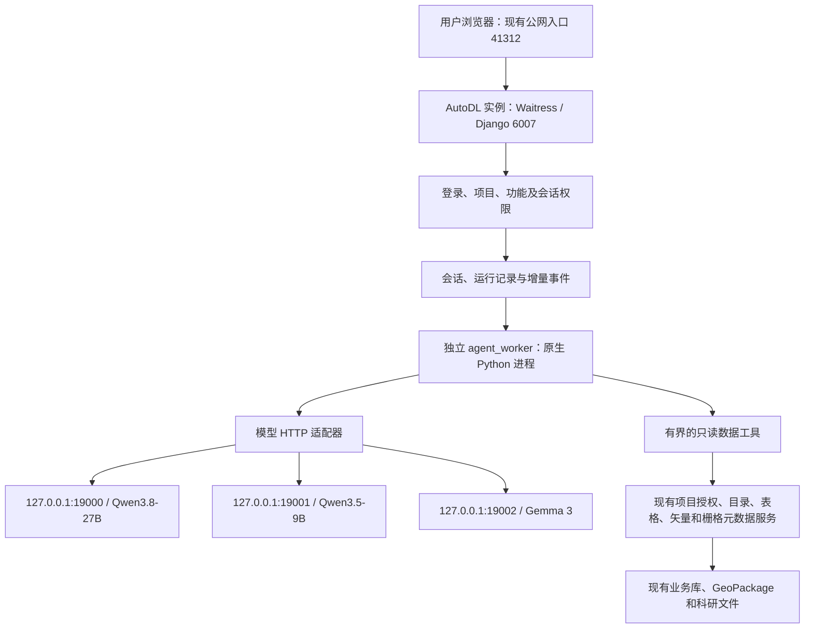

# 智能体模块设计与实现方案 V2：李老师服务器

日期：2026-09-20。状态：首版开发已完成本地实现与 Mock 验证，等待李老师服务器候选部署和真实数据验收。

本方案替代本任务上一版设计。依据用户指定任务“设计系统自动同步方案”的近期上下文、现有部署回执、本地模型部署资料及当前代码重新设计。本次读取历史证据，没有重新连接服务器检查模型实时状态。

## 1. 已核实的部署背景与修正

| 项目 | 从上下文与文件提取的事实 |
| --- | --- |
| 目标环境 | 李老师服务器的 AutoDL Ubuntu 实例；提供的 SSH 登录进入该实例 |
| 维护入口 | `101.42.12.157:57865`；凭据不写入方案 |
| 用户访问入口 | `http://101.42.12.157:41312` |
| 平台内部监听 | Waitress 直接运行，端口 `6007` |
| 平台运行方式 | 实例内 Python 原生进程，没有另起用于承载 GeoManager 的 Docker 容器 |
| 计算中心 | 已改为原生 Python worker / 子进程，v0.1.3 部署验收记录确认；本功能不接入它 |
| 最近部署回执 | v0.1.5，提交 `f8ae866d6893fd300539e38b32758521855b21f6`；记录时间 2026-09-20 |
| 当前代码目录（按最近回执） | `/root/autodl-tmp/geomanager-deploy-0.1.5-f8ae866` |
| 配置 | `/root/autodl-tmp/geomanager-config-20260919/app.toml` |
| 数据根目录 | `/root/autodl-tmp/geomanager-data-20260919`，代码必须从 TOML 读取具体 app/research 根路径 |
| 启动入口 | `/root/autodl-tmp/geomanager-start-6007.sh`、`/etc/autodl-geomanager.sh` |
| 发布方式 | 本机向服务器上传并验收，再从本机向 GitHub 同步同一提交；服务器主动拉取 GitHub 仍有网络限制，每日自动更新未启用 |

“AutoDL 实例本身采用容器技术”不代表“GeoManager 单独以 Docker 部署”。上一版据仓库 Docker 示例提出的网桥转发方案不适用于这个现网，撤销该建议。

资料指出模型位于 `/root/autodl-tmp/users/grp_personal/`，平台与模型使用独立 Python 环境。按用户此次明确的服务器身份，本方案以两者在同一 AutoDL 实例内为目标，通过回环 HTTP 通信。实施前从**平台进程所在的网络环境**核实模型端口及实际模型 ID；目录相似和 SSH 入口本身不能替代该检查。

另两项修正：

- 当前数据阅读范围由项目标签决定，角色控制操作权限；历史 `access_groups` / `audience_groups` 不再决定对象阅读范围。智能体不得重新引入旧规则。
- 第二栏要有“查找数据 → 读取 → 统计 → 检查 → 回答”的多步能力。只有手工选资源后做一次摘要问答，不足以实现用户期望的智能体。

## 2. 目标与首期范围

顶部“智能预警”改为“智能体”。模块左侧固定两个入口，顺序如下：

1. **模型对话**：像常用聊天产品一样，与本地模型进行连续对话。
2. **数据智能体**：围绕用户问题，自主使用受控的数据读取与基础统计能力，在当前项目的授权数据内完成分析。

两个入口共用会话、模型接入、消息展示和历史记录基础设施，使用不同的能力清单与提示模板。普通对话没有平台数据工具；数据智能体可以访问经过授权的数据服务。

首期不调用计算中心的算法包、NDVI 等业务算子，不接入任意 Shell/Python 执行，不自动改库、删文件或发布成果。模型输出代码时仅作为文本展示。筛选、分组、求和、均值等属于平台提供的只读数据分析能力，不接入算子登记和调度体系。

## 3. 页面与交互

### 3.1 导航和页面结构

- 主入口 `/agent`，默认到 `/agent/chat`；第二入口 `/agent/workbench`。
- `/warning` 只保留一次路由跳转，去掉旧预警宣传内容，不保留两套业务实现。
- 保留顶部平台导航、项目标签选择及中英文界面。
- 左侧上方：两个模式入口；其下：新建会话、当前模式的历史列表、搜索、重命名、归档和删除。
- 中间：消息区与固定底部输入框；长表格横向滚动，长消息不挤压输入区。
- **模型选择器位于输入框下方**，显示名称、可用状态；两个模式可分别记住用户上次选择。
- 数据智能体右侧增加可折叠的“本次数据与依据”面板，展示资源、筛选范围、统计表和引用。
- 窄屏将历史和依据面板收进抽屉；保持中文输入法、键盘换行与滚动体验。

### 3.2 模型对话

- 新建、继续、复制回答、停止生成、失败重试、重新生成和历史恢复。
- 支持 Markdown、代码块、表格；对渲染内容做安全处理，不执行 HTML/脚本，不自动加载模型生成的远程图片。
- 首期只收文本；图片问答和临时附件上传暂缓。文档写有模型架构不代表当前服务已经验收图片输入。
- 切换模型从下一轮生效，旧消息保留实际生成模型标记；正在生成时不切换本轮模型。
- 新模型使用经预算控制的可见会话历史。上下文压缩应提示用户，不默默丢弃关键问题或数据依据。
- 失败或服务离线时保留已生成文字并标记“未完成”；用户可显式重试或换模型，不静默替换成其他模型。

### 3.3 数据智能体

默认范围为“当前项目内我可访问的数据”，同时支持用户通过数据选择器或 `@数据资源` 缩小范围。一次会话固定一个具体项目，不支持跨项目 all 汇总。

示例任务（仅演示操作方式，不代表服务器现有数据）：

> 找到当前项目中近三年的样地监测记录，比较各年份某指标的变化，并指出缺失数据对结论的影响。

执行过程展示可核对的操作状态：

1. 查找相关数据；
2. 查看字段、单位和时间范围；
3. 按年份计算记录数、有效值数及指定统计；
4. 检查不同年份是否可比；
5. 输出结论、表格、数据来源和限制。

展示的是工具执行状态、统计口径和简要行动说明，不显示模型的原始内部思维链。数据重名、单位不明、比较对象不确定时，在当前对话中询问用户；已经明确且允许的只读步骤无需逐步确认。

首期回答可包含结构化表格和受控图表。图表只由真实统计 JSON 驱动，使用白名单图形组件，不运行模型生成的 JavaScript。用户能查看图表对应的数值和来源。

## 4. 适合当前服务器的架构



模型进程仍使用师弟的 `llm-serving` 环境，平台和 agent worker 使用平台运行环境。平台不导入模型权重，不安装另一套 CUDA/vLLM，不抢占 GPU 6–7，也不从聊天页面启动或停止模型服务。

普通对话和智能体运行都经同一个持久任务层提交，但与计算中心任务队列分开，避免模型等待占用算子 worker。

### 4.1 网页响应与增量输出

当前平台使用同步 Waitress；不能让每个长时间模型回答一直占住网页线程。首期推荐：

1. 网页提交问题，Django 校验后快速返回 `runId`（202）。
2. agent worker 在后台连接 vLLM，读取上游流式响应。
3. worker 合并文本片段，每 0.5–1 秒或达到大小阈值持久化一次增量事件，避免逐 token 写 SQLite。
4. 网页通过带游标的短请求获取新片段；前台生成期间约每 0.5–1 秒请求一次，排队、后台页面适当降频；终态停止。
5. 用户看到连续增量输出；刷新后按会话和游标恢复，不重新生成一遍。

这一方案复用现有公网映射，不增加对外端口，不要求现有入口支持 SSE 长连接，也不需要修改整个站点的 WSGI 运行方式。后续如有更低延迟要求，再将独立 ASGI/SSE 通道作为部署升级；首期不把它设为前提。

短轮询并不证明现网不支持 SSE，只是当前方案降低对代理行为和 Waitress 长连接的依赖。须用真实公网入口验收逐段显示、请求数和普通页面响应。

### 4.2 worker 的任务生命周期

`queued → running → succeeded / failed / cancelled / interrupted`；等待用户补充时进入 `waiting_input`，续答创建关联后续运行。

- 使用短事务、唯一约束和原子抢占防止重复执行；同一会话只允许一个活动运行。
- 每次提交带幂等键，重复点击或网络重试返回同一运行。
- worker 记录心跳与租约；重启后识别遗留运行，标记中断，不重放不确定的模型步骤。
- 取消按钮写入取消状态；worker 关闭上游请求并结束后续工具调用。关闭连接能否及时释放 vLLM 推理资源需实际验收。
- 任务排队时保存 requester 和 project ID；执行时重新加载用户权限并显式建立 `ProjectScope`，不能借用退出请求后已经重置的上下文。
- SQLite 使用既有 WAL、短事务和有限重试；token 生成期间不持有事务或数据库锁。队列抢占、取消、撤权与事件写入须做并发测试。

## 5. 三个模型的接入策略

以下参数来自用户提供资料，验收记录日期为 **2026-09-02**。它们是部署基线，不是今天的在线检测结果。

| 显示名称 | 实际 API ID（需复核） | 地址 | 资料中 GPU | 首期定位 |
| --- | --- | --- | --- | --- |
| Qwen3.8-27B | `Qwen/Qwen3.8-27B` | `http://127.0.0.1:19000/v1` | 0–3 | 数据智能体候选默认模型 |
| Qwen3.5-9B | `Qwen/Qwen3.5-9B` | `http://127.0.0.1:19001/v1` | 4 | 普通聊天候选默认模型 |
| Gemma 3 12B IT | `google/gemma-3-12b-it` | `http://127.0.0.1:19002/v1` | 5 | 可切换聊天模型；智能体能力单独评测 |

三者配置上下文长度为 32768。模型的速度、分析质量、并发容量不能仅靠参数量推断，默认模型建议以部署后的同题实测收敛。

### 5.1 能力验证和模型适配

- 先验证 `/v1/models` 的精确模型 ID，再验证中文对话、流式响应、超时和取消。
- Qwen 首期沿用部署自检的 `enable_thinking=false`；Gemma 不发送 Qwen 专属参数。思考模式后续仅在模型特性和输出格式验证后开放。
- 普通聊天通过验收不等于原生 tool calling 可用。需要检查启动参数、工具解析器、chat template、JSON schema 支持与错误表现。
- 优先使用验收通过的原生工具调用；如只支持结构化 JSON，可采用“action + arguments / final”的受控协议，由服务端严格校验和执行。
- 无法稳定遵循协议的模型只开放聊天，不显示为可用智能体模型。不因为 API 格式兼容，就承诺三个模型都能完成智能体任务。
- 结构化参数不合法时最多纠正一次，仍失败即结束并给出可读提示，禁止解析自然语言片段当作可执行命令。
- 对文档、工具返回和检索文本均按不可信数据处理；其中“忽略权限”“读取其他目录”等文本不会改变工具权限。

### 5.2 配置与容量

在现有 TOML 新增 `[application.agent]` 及模型注册项，配置包括：启用开关、稳定别名、base URL、实际模型 ID、chat/agent 能力标记、默认模型、上下文和输出预算、超时、每模型并发、用户配额。

- base URL 仅由部署管理员配置，首期仅允许核实后的本机服务；客户端或模型不能提交任意 URL。
- 后端返回显示名、别名、模式支持与近期状态，不下发端口、路径或凭据。
- 建议试运行初值：每人最多 1 个活动运行，每模型最多 1 个正在生成请求，总计最多 3 个；排队单独计数。压测后再提高。
- 智能体最多 8 个工具动作、最多 3 个资源同时参与详细分析；超限时要求缩小问题或结束并给出已完成结果。
- 聊天最大输出初值 2048 token，智能体 4096 token；输入、系统提示、历史、工具定义及工具结果合计预算预留输出空间和余量，不能把 32768 全部用作输入。
- 能可靠使用部署 tokenizer 时准确计数；否则采用保守预算并明确处理上游长度错误，不能把中文字符数当成精确 token 数。
- 总时限初值聊天 180 秒、智能体 600 秒；连接和读取超时分别设置。以上均为建议配置，不是模型性能承诺。
- 可用性检查使用短超时与缓存；请求普通平台 `/api/health/` 不串行等待三个模型。一个模型离线只影响对应服务，不拖垮地图和数据管理。

## 6. 数据智能体的执行能力

### 6.1 受控数据工具

这些工具是平台内建的服务函数，未向智能体开放任意后端 API。

| 工具 | 作用 | 约束 |
| --- | --- | --- |
| `search_resources` | 按名称、说明、类型和日期发现资源 | 当前项目内授权后再检索、计数和返回；结果条数有限 |
| `describe_resource` | 查看字段、单位、格式、时空范围和规模 | 使用资源 ID，隐藏存储路径和不必要内部信息 |
| `read_rows` | 查看所需字段与有限记录 | 字段白名单、行数和字节上限；不接收原始 SQL |
| `summarize_data` | 缺失率、计数、最值、均值、标准差、分类频数 | 返回统计口径、有效数、样本/全量标记；不混淆样本与总体 |
| `aggregate_data` | 按字段或时间分组统计 | 验证字段和聚合函数；由服务端构造参数化查询或有界处理 |
| `compare_summaries` | 对比两个以上已核实摘要 | 检查单位、过滤条件、年份和空间范围；可计算差值但不能自动宣称因果 |
| `read_document` | 读取已授权文档的有限文本片段 | 按能力逐步开放；纯文本和有文本层 PDF 优先，不执行文档内代码或外链 |

当前实现先开放 UTF-8 纯文本、Markdown 和 CSV 正文片段；PDF、扫描件 OCR 和复杂版式解析保留在后续扩展，不把资源元数据或摘要当作已读全文。无证据证明已部署 embedding/reranker，因此一期不要求向量数据库，先使用授权范围内目录检索及有界文本检索。

基础统计由确定性程序得到，模型负责组织查询、解释和推理。模型不能拿几十条示例自行猜测整表平均数。

### 6.2 分类型接入

| 资源类型 | 一期可提供能力 | 明确限制 |
| --- | --- | --- |
| SQLite 表格、CSV/TSV/XLSX | 字段、筛选样本、有界统计、分组比较 | 大文件分块/查询下推；Excel 不执行宏；不能无条件整文件读入 |
| 矢量 | 字段、要素数、已有空间范围、属性查询与统计 | 不进行新缓冲、叠加、栅格化等算子任务；不无条件发送完整 GeoJSON |
| 栅格 | 元数据、波段、尺寸、CRS、范围、已有统计 | 不直接读取全幅像元交给模型，不承诺图像解译或变化检测 |
| 基因文件 | 复用已支持格式的结构摘要与有界统计 | 不进行新序列计算或完整大文件提示注入 |
| 文档 | 资源说明、UTF-8 纯文本/Markdown/CSV 的有界正文片段 | PDF、扫描件 OCR、复杂版式还原另行扩展 |
| 图片 | 名称、来源、说明等元数据 | 首期没有视觉问答 |

现有 `nongeo.py` 的分析上限为 10000 条；有些直接文件路径会先读全文件再截取。因此不能直接把现有接口当作支持任意大文件、全量统计的智能体工具。需抽取公共服务并加入读取字节数、行数、超时和结果范围校验。

### 6.3 证据与可靠性

工具返回统一携带：资源 ID、项目 ID、读取时版本标记/指纹、字段和单位、筛选条件、总记录数、实际分析数、是否抽样、执行时间、工具结果 ID。

- 引用 ID 由服务端产生，模型只能引用本轮允许的证据集合；未知引用拒收或降级为无依据陈述。
- 回答区分“数据统计事实”“解释性推断”“尚缺资料”。相关性不能写成已证实因果。
- 支持句旁引用和右侧详情，按资源或文档片段定位；点击查看再次鉴权。
- 跨轮复用的摘要保留来源依赖，资源版本变化时标记历史快照并重算必要统计。
- 用户问题超出一期能力时说明可回答的部分，例如现有统计可以解释，但无法新做遥感分类。

## 7. 权限、会话归属与数据隔离

### 7.1 权限来源

首期新增 `core.use_local_model` 和 `core.use_data_agent`，在现有 Django 权限清单、后台授权和 `/api/auth/me/` 中同步。

| 用户类型 | 建议普通聊天 | 建议数据智能体 |
| --- | --- | --- |
| 游客或匿名 | 不开放 | 不开放 |
| 普通登录用户 | 默认开放，可由管理员取消 | 默认不开放，可单独授权 |
| 科研用户 | 开放 | 开放 |
| 平台管理员 | 开放 | 开放，但只能访问有权进入的项目 |
| 超级管理员 | 开放 | 开放，仍需选一个具体项目 |

此表是待审核的默认分配建议，不是已执行的授权。数据智能体还需要 `core.browse_data` 与 `core.query_data`。普通聊天不依赖数据查询权限。旧 `core.ai_interpretation` 继续用于原地图占位，不直接等同于新权限。

### 7.2 必须落到服务端的校验

- 当前会话归属登录用户和一个具体项目。即使公开项目 ID=1，用户之间也不能查看彼此的聊天。
- 目录发现、字段读取、统计、正文读取、消息获取、事件拉取、引用查看和取消运行分别校验。
- worker 不使用 root/Linux 账号身份代表平台用户；文件由数据适配器按照已鉴权的资源 ID 解析。root 的系统权限不能变成模型能力。
- 每个工具步骤、上下文拼接、最终回答返回前重新校验账号和项目成员关系；功能权限也重新加载，避免 Django 用户权限缓存残留。
- 项目、资源或功能权限撤回后，停止后续读取；服务端不继续向客户端发送受影响的结果。已存在的消息、摘要、缓存和引用同样按来源依赖重新检查，不能仅检查原始文件。
- 已经展示或复制到用户本地的内容无法远程收回；撤权约束作用于之后的服务端读取与模型调用。
- 项目切换时清空旧页面状态，取消旧运行并防止旧请求回填；不能把旧项目的对话历史带到新项目。
- 对不可见会话/资源返回不暴露其存在性的 404；功能权限不足为 403，未登录为 401。

## 8. 持久化与接口

### 8.1 数据模型

| 模型 | 主要字段与规则 |
| --- | --- |
| `AgentConversation` | owner、project_tag、mode、title、default_model、状态、时间；历史只供本人 |
| `AgentMessage` | conversation、角色、正文、生成模型、状态、引用、token 使用量（若上游提供） |
| `AgentRun` | requester、project_tag、conversation、幂等键、模型及提示版本、状态、取消标记、租约、时限、用量 |
| `AgentRunEvent` | run、递增序号、事件类型、有限 payload；用于断线恢复及状态重建 |
| `AgentEvidence` | run/message、资源与版本、查询条件、统计范围、受限摘要和结果索引；继承资源权限依赖 |

关系在创建和读取时校验项目一致性；唯一幂等键包含用户/会话范围。建议业务库仅存有界数据；较大的中间内容放在 TOML 业务根目录下的固定 `projects/<id>/agent/` 路径，通过鉴权接口读取，不能作为公开静态文件。

建议运行中间材料保存 7 天后清理；保留回答所需的轻量证据与来源信息，聊天历史由本人删除。用户删除会话时删除关联正文、派生摘要和临时文件，保留不含正文的最低限度审计记录。备份中的历史副本按既有备份保留策略过期，不声称立即从备份抹除。

### 8.2 建议 API 契约

统一前缀 `/api/agent/`。仍使用 Session、CSRF 和 `X-Project-Id`，所有 AI 接口要求真实登录，不加入公开读接口白名单。

| 方法和路径 | 用途 |
| --- | --- |
| `GET models/` | 当前用户可用模型、近期状态、聊天/智能体能力 |
| `GET/POST conversations/` | 分页列表、新建会话 |
| `GET/PATCH/DELETE conversations/{id}/` | 会话详情、重命名/归档、删除 |
| `GET conversations/{id}/messages/` | 分页历史消息与有效引用 |
| `POST conversations/{id}/runs/` | 提交问题，返回运行 ID；支持幂等键 |
| `GET runs/{id}/` | 当前状态、耗时和已生成回答摘要 |
| `GET runs/{id}/events/?after=<cursor>` | 快速返回有界增量事件和下一游标 |
| `POST runs/{id}/cancel/` | 持久取消并通知 worker |
| `GET resources/` | 当前项目内授权资源，供用户筛选/限定范围 |
| `GET evidence/{id}/` | 复核来源和统计结果，实时重新鉴权 |

事件类型包括 `queued`、`status`、`tool_started`、`tool_completed`、`text_delta`、`citation`、`waiting_input`、`completed`、`failed`、`cancelled`。HTTP 返回前错误使用标准 `{"detail":"..."}`；异步失败放入运行状态及错误事件，不返回模型原始堆栈或服务器路径。

普通聊天禁止附带平台 resourceIds；智能体模式记录范围为 `current_project` 或 `selected_resources`。具体项目和用户由后端上下文决定，不能采用模型生成的身份参数。

所有契约先写入 `docs/openapi.yaml`，随后同步 developer guide、API change request、mock 和生成类型；新权限字段同步前后端与测试。

## 9. 代码与运维实施清单

### 9.1 代码组织

新增 `backend/apps/agent/`：模型、URL/views、配置、模型适配、运行队列、上下文预算、证据管理、只读工具以及 `management/commands/agent_worker.py`。

新增 `frontend/src/agent/`：页面布局、模式菜单、会话列表、输入组件、模型选择、消息渲染、运行步骤、依据面板、增量拉取 hook 及样式。

最小修改现有：

- `App.tsx`、`WorkspaceHeader.tsx`、中英文资源、旧 WarningPage 路由；
- 权限注册、默认角色迁移、用户权限序列化及后台授权展示；
- `geomanager/settings.py`、`urls.py` 注册新应用；
- 表格/矢量服务抽取可复用的有界读取函数，保留原页面语义；
- TOML 配置示例、服务启动脚本及备份说明；
- API 契约与类型；部署、操作和实现文档。

现有文档仍有“只允许 Docker”的历史计算条目，以及 Docker 自动同步示例。实施时将其和当前已验收的 native 状态标明适用环境，不再拿旧文档覆盖用户已明确的服务器架构。

### 9.2 运维与发布

- 新增独立 agent worker 的启动、停止、PID 身份核验、心跳和日志，不与 compute_worker 共用执行队列。
- 使用现有实例启动钩子启动平台相关进程，不假设该 AutoDL 实例具备 systemd 服务管理能力。
- 平台更新只重启平台及其 worker，不重启师弟的 vLLM，不改其环境、GPU 绑定或权重。
- 管理日志记录用户、模型、项目、耗时、资源 ID、状态和用量；不把完整聊天和数据行写进普通运维日志。
- 新依赖与当前平台 Python 版本核对；如服务器下载受阻，由本机准备匹配 Linux/Python 的依赖包，不从服务器反复拉 GitHub。
- 发布先做新目录候选验收与备份，再做增量迁移和切换。当前一期优先采用新增表，便于回退代码时保留新会话数据，不回滚整个业务库覆盖期间的新写入。
- 沿用本机 → 服务器验收 → 同一提交到 GitHub 的流程；本轮仅方案，不执行部署。

## 10. 开发阶段与交付

下列为工作量规划值，待模型协议验证后收敛，不是已经测得的工期。

| 阶段 | 交付 | 退出条件 | 估计工作量 |
| --- | --- | --- | --- |
| P0 环境和模型验证 | 确定实际网络环境、3 个模型能力表、取消/流式/结构化协议记录 | 平台运行环境能直接访问模型；至少一个模型可稳定完成两步数据工具任务 | 0.5–1 人日 |
| P1 契约与基础设施 | API、权限、会话/运行/事件表、worker、配置和模型适配 | 幂等、取消、恢复、权限测试通过 | 2–3 人日 |
| P2 普通聊天 | 两栏框架、三模型选择、增量回答、历史记录 | 三模型真实对话、公网访问与项目切换通过 | 1.5–2 人日 |
| P3 数据智能体 | 自动发现、元数据、样本、统计、比较、引用和表格/图表 | 用真实授权表格/矢量数据完成完整多步任务 | 3–4 人日 |
| P4 文本资料与综合验收 | 有界文档读取、撤权/注入/并发测试、发布包 | 安全边界、容量和原模块回归通过 | 2–3 人日 |

完整一期估计 9–13 人日。可先交付 P2 供界面试用；完整一期验收仍包含 P3/P4，不把只有聊天的页面称为数据智能体交付完成。

## 11. 验收标准

### 11.1 环境与模型

- 从平台所在环境访问 19000/19001/19002，并核对返回模型 ID；记录日期，不能沿用 9 月 2 日 READY 作为新验收。
- 不新增模型公网映射；普通用户只使用现有站点入口。
- 三模型分别通过聊天；智能体候选模型另测工具名/参数、错误纠正、工具结果复用和多步终止。
- 单模型离线、上游超时和 worker 停止都有可读状态，地图、登录和查询继续可用。

### 11.2 多用户与项目权限

- 同一公开项目中用户 A 不能读取用户 B 的会话、事件和证据。
- 篡改 resource ID、conversation ID、run ID、project header、游标都不能绕过授权。
- 平台管理员没有被分配的私有项目仍不能访问；超级管理员也不能在一次运行中跨项目拼接。
- 排队期间停用账号/撤回成员、执行中撤销权限、历史重新打开等场景均生效。
- 恶意文档提示词不能触发目录遍历、服务器文件访问、执行程序或调用算子。

### 11.3 分析准确性与体验

- 全量/抽样标记、筛选条件、总数、有效数和单位与已知答案一致；超过 10000 行的用例不能把样本统计写成全量结论。
- 至少覆盖资源不存在、同名候选、空表、全空字段、单位不一致和数据不足。
- 引用可打开到真实证据；资源失效或权限撤销后不会继续从缓存展示受限内容。
- 公网逐段输出、刷新恢复、重复提交、停止和失败重试均可用；HTTP 环境下复用平台已有 UUID 兼容实现。
- 并发压力验证不出现 SQLite 锁导致 worker 退出；确认普通页面相对基线无明显退化，再决定提高并发。

### 11.4 工程验证

实施时执行 API lint/生成/check、API changes/docs、针对 agent 的后端测试、前端单元与浏览器测试、类型检查和生产构建；涉及公共权限/项目服务时补对应回归。真实模型使用与生产业务数据写入相隔离的测试会话和合成数据，最后再执行有授权的只读业务用例。

实现状态：已新增 `/api/agent/` 契约、会话/运行/事件模型、独立 worker、OpenAI 兼容适配器、只读数据工具、模型 Mock、前端模型对话/数据智能体页面及超管策略页面。已在本机合成数据完成 14 项智能体集成测试、前端类型与静态检查；真实服务器只读检查确认 19000 在线、19001/19002 离线，尚未发布到线上。发布仍需按本机冻结提交 → 服务器新目录候选 → 真实模型和只读数据验收 → 切换 → GitHub 同提交的流程执行。

## 12. 已确认的产品决策

用户已确认以下决策，后续实施以此为准：

1. 模块名为“智能体”，两栏名为“模型对话 / 数据智能体”。
2. 同一 AutoDL 实例内直接访问回环模型服务；不增加用于承载 GeoManager 的 Docker 部署，不开放公网模型端口。
3. 数据智能体默认可以在当前项目内自主发现用户有权限访问的数据；用户仍可手动选择资源缩小范围。
4. 首期提供受控只读统计，不接入计算中心算子、任意代码执行或自动数据写入。
5. 普通聊天向正式登录用户开放；数据智能体默认面向科研用户和管理员，普通用户可由超管单独授权。
6. 先做 P0 真实模型和工具协议验证，再依次完成普通对话和完整数据智能体；Qwen 模型默认定位以实测为准。

### 12.1 超级管理员的可见范围控制

“可见范围”分为产品能力可见范围和数据访问范围，两者不得混为一谈：

- 超级管理员可以控制哪些用户组/用户看到“智能体”入口、普通聊天、数据智能体和指定模型。
- 超级管理员可以关闭某个模型、把模型限制为聊天用途，或允许它参与数据智能体。
- 超级管理员可以设置普通聊天和数据智能体的默认模型、模型排序和用户/组级配额。
- 这些设置只能收窄能力，不能让用户访问其项目成员关系和资源权限之外的数据。
- 数据智能体的实际资源访问仍由当前项目、用户状态、项目成员关系、`core.browse_data`、`core.query_data` 和资源状态共同决定。
- 游客永远不通过模型可见性设置获得聊天或数据智能体权限。

建议在后台新增“智能体管理”页面，只有超级管理员可访问：

| 区域 | 超管可配置内容 |
| --- | --- |
| 功能总开关 | 是否启用模型对话、是否启用数据智能体 |
| 用户范围 | 哪些用户组可见；必要时添加单个用户例外 |
| 模型范围 | 启用状态、聊天/智能体能力、可见用户组、排序和默认模型 |
| 额度策略 | 单用户并发、每日次数、最大输出长度、单次工具步数 |
| 数据策略 | 允许的数据类型、是否允许文档正文、是否允许跨资源比较；范围只能收窄当前项目授权 |
| 运行状态 | 模型在线状态、最近错误、队列长度、平均响应耗时 |

模型 `base_url`、实际模型 ID、GPU 绑定和服务启动命令继续保留在服务器 TOML/运维配置中，后台页面不提供任意 URL 输入，避免把管理页面变成 SSRF 或模型服务转发入口。

实现上建议增加 `AgentModelPolicy`（稳定模型别名、能力开关、排序、默认标记、可见组）和 `AgentAccessPolicy`（功能总开关、可见组/用户例外）两类配置。它们引用 TOML 中的模型注册，不复制密钥、路径或模型权重信息。现有 Django 功能权限继续作为硬门槛，策略只允许进一步限制。

### 12.2 为未来工具调用预留能力

首期不启用算子调用，但从第一天采用可扩展的能力模型：

```text
AgentCapability
├── chat                  # 首期启用
├── read_data             # 首期启用
├── analyze_data          # 首期启用
├── execute_operator      # 预留，首期关闭
├── write_data            # 预留，首期关闭
└── publish_result        # 预留，首期关闭
```

工具层统一使用 `ToolSpec → PolicyCheck → Execute → ToolResult` 接口，运行事件已经预留 `tool_started`、`tool_completed` 和失败状态。首期只注册查找资源、字段读取、样本、统计和比较工具；算子工具不注册为可调用工具，因此模型即使生成相应名称也会被拒绝。

未来接入计算中心时，新增的 `execute_operator` 适配器必须通过现有计算中心 API，继承项目归属、输入资源权限、队列、超时、取消、结果下载和入库规则，不能让模型直接启动进程。写入和发布能力还需要单独的用户确认或后台审批，不因工具接口预留而默认开启。

## 13. 本机开发、李老师服务器验证与发布流程

由于只有李老师服务器部署了真实模型，本项目采用“本机完成确定性开发，服务器完成模型和部署验收”的双环境流程。每一阶段都保留可回退的发布包和验证证据。

### 13.1 本机开发阶段

本机不等待真实模型才能开发：

1. 先完成 OpenAPI 契约、权限、数据库模型、配置解析和工具接口。
2. 使用项目内的假模型服务模拟 vLLM OpenAI 兼容接口，固定返回普通文本、分片文本、工具调用、超时、错误和取消场景。
3. 使用测试项目和合成表格/矢量数据，测试当前项目、资源权限、数据摘要和证据引用。
4. 前端默认指向假模型/Mock API，浏览器测试不连接李老师服务器，不依赖公网，不消耗 GPU。
5. 后端单元测试覆盖模型 ID 映射、SSE/短轮询事件、工具参数校验、预算、幂等、并发、撤权和注入内容。
6. 每个阶段先通过本机 API lint、类型检查、前后端测试和生产构建，再准备候选发布包。

本机 Mock 必须模拟三个模型别名和实际可能出现的 vLLM 响应差异，不能只返回一个永远成功的字符串。这样模型未接入时，绝大多数 UI、权限、数据和任务逻辑仍可完成验证。

### 13.2 推送前的本机候选包

每次送服务器前生成一个包含以下内容的候选包：

- Git 提交号和工作树摘要；
- 后端源码、前端构建产物和依赖锁文件；
- 数据库迁移清单；
- OpenAPI 与生成类型校验结果；
- 配置变更说明，不包含模型地址密钥以外的生产凭据；
- 候选包 SHA-256；
- 本机测试和 Mock 模型验证结果。

当前发布流程是本机上传服务器，不让服务器主动访问 GitHub。候选包上传到新的 `/root/autodl-tmp/...` 目录，不覆盖线上 v0.1.5 目录。

### 13.3 服务器候选部署

服务器上使用独立候选目录和临时端口进行验证：

1. 只读记录当前 Waitress、agent worker、模型进程、端口、配置哈希和数据库计数。
2. 备份当前应用目录、启动脚本、配置和数据库；不复制或修改师弟模型权重。
3. 解压候选包，运行代码检查、迁移检查和前端静态文件检查。
4. 使用业务数据库的候选副本启动候选 GeoManager 实例，例如绑定 `127.0.0.1:16007`，避免影响线上 `6007`。
5. 候选实例连接李老师服务器本机的三个模型端口，检查 `/v1/models`、中文聊天、流式/事件转换、超时和取消。
6. 用合成测试项目或已明确授权的只读数据完成两类真实模型任务：普通对话一次，数据智能体多步统计一次。
7. 启动候选 agent worker，验证租约、事件、重复提交、刷新恢复和停止；候选数据库不写入线上业务库。
8. 保存候选日志和 `server-candidate-receipt.json`，其中记录提交号、模型 ID、端口、结果摘要和时间。

候选验证失败时保持线上服务不动。不能为了“看看模型能否访问”直接重启线上 6007，也不能在生产数据库上反复迁移试错。

### 13.4 线上切换和真实验证

候选通过后再安排切换窗口：

1. 先确认没有正在进行的发布、数据库迁移或重要计算任务。
2. 备份最新配置和数据库；记录模型服务 PID/启动命令，不操作模型服务。
3. 执行新增表迁移和静态文件切换；迁移设计保持向前兼容，避免需要覆盖线上数据库回滚。
4. 按进程身份停止并启动平台 Waitress 和独立 agent worker。
5. 通过内部 `6007` 和现有公网 `41312` 验证登录、地图、数据查询、普通聊天、数据智能体和后台超管设置。
6. 逐个记录三个模型的在线状态；若某个模型不可用，只将其置为不可选，不影响系统其他功能。
7. 完成真实模型最小验收后生成服务器回执。

真实数据用例只使用当前用户被明确授权的项目和数据；优先使用合成或公开项目数据，避免把无关私人数据作为模型测试材料。模型回答、数据行和凭据不写入发布日志。

### 13.5 回滚和 GitHub 同步

- 应用启动失败、迁移检查失败、模型代理异常或原有平台回归失败时，按进程身份恢复旧应用目录和启动脚本。
- 不用旧数据库副本覆盖线上数据库，以免丢失切换期间的新写入；新增表迁移应保持旧代码可启动，无法做到时先停止发布。
- 回滚后重新验证健康接口、登录、地图和已有数据查询，再保留故障证据。
- 服务器验收通过后，从本机将**同一 Git 提交**推送 GitHub；服务器不主动拉取 GitHub。
- GitHub 推送失败不影响已验收服务器；记录候选包 SHA 和提交号，后续从本机补传。
- 只有本机、服务器和 GitHub 三方的提交号及构建摘要一致，才将版本标记为已发布。

该流程不会把“本地 Mock 通过”写成“真实模型通过”，也不会把“服务器网页健康”写成“数据智能体验收通过”。

## 14. 需要在 P0 阶段确认的事项

用户已经确认产品范围，P0 只剩环境事实核验：

1. 平台 Waitress 所在进程能否访问 `127.0.0.1:19000–19002`；
2. 三个接口今天返回的实际模型 ID 是否仍与资料一致；
3. 启动参数是否支持稳定的流式输出、取消和受控结构化工具调用；
4. AutoDL 实例是否允许增加一个长期运行的 agent worker 进程及其启动钩子；
5. 现有 vLLM 服务的 GPU/并发余量，普通聊天与数据智能体的默认模型是否需要调整；
6. 选定用于服务器真实验证的合成或公开测试数据，不把线上私有数据复制到候选目录。

P0 通过后才锁定具体模型默认值、并发、超时和实时事件传输方式。

## 附录：证据定位

- Codex 任务“设计系统自动同步方案”，ID `01a0ba2f-c0a7-7541-8b2c-80e43bf1a3a9`：用户确认 AutoDL 不使用 Docker、native 计算改造、v0.1.5 发布、内容修复和发布顺序。
- `_releases/v0.1.5-f8ae866/server-receipt.json`（工作区父目录下）：最近发布版本、端口、配置保留及健康结果。
- `_server_ops/release-015.py`（工作区父目录下）：代码/配置/数据目录和原生 Waitress/worker 进程核验方式。
- `docs/2026-09-20-server-sync-audit.md`：Waitress/AutoDL 形态、启动脚本与网络限制；早期源码目录以最新回执更新。
- `docs/current-platform-rules.md`、`backend/apps/projects/`、`backend/apps/catalog/permissions.py`：单项目、项目成员和当前数据权限。
- `backend/apps/catalog/nongeo.py`：当前统计和读取边界。
- 用户资料目录 `C:/Users/Administrator/OneDrive/项目/260917时空智能服务平台开发/260920服务器大模型配置情况/` 内的 01 使用与运维指南、02 部署状态与验收记录、03 部署脚本 SHA256 核对清单。目录包含这三份文件，未见文档引用的完整 04 验收证据目录。
