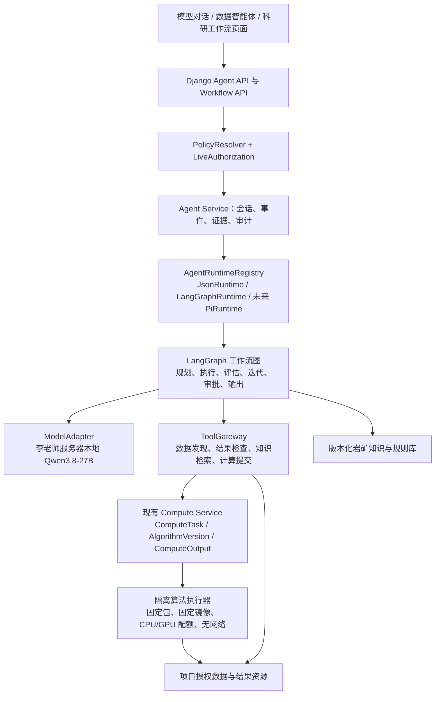

# LangGraph 与 Pi Agent 评估及科研工作流智能体架构方案 V2

日期：2026-09-21  
状态：设计评估稿，**未安装 LangGraph，未替换现有 worker，未开放智能体调用算子**。  
适用范围：高光谱影像解译、矿物/岩性识别、成矿理论约束下的参数迭代，以及后续生态诊断等编排型科研任务。

本稿根据新的业务目标修订上一版只读数据智能体方案。上一版仍然有效的首期边界是：普通聊天可用，数据智能体先提供受控只读分析，不开放算子、任意代码、主机命令、写入和发布。本文把“以后要完成的算子编排闭环”设计成可验证的目标架构，实施时必须按本文的阶段门槛逐步打开。

## 1. 业务目标重新定义

高光谱解译任务不是一次模型问答，而是一个有输入、算法、约束、结果和验收条件的科研工作流：

1. 用户在平台上发布任务，选择当前项目内的目标高光谱影像，或允许智能体在授权范围内发现候选影像。
2. 智能体根据任务目标选择已登记、已发布且允许被智能体调用的岩性/矿物解译算法，生成符合算法清单的参数。
3. 平台通过现有计算中心提交一个固定算法版本的计算任务。算法在隔离运行环境中读取输入，产生分类结果、置信度、统计表和质量指标。
4. 智能体读取受控的结果摘要和证据，结合版本化的成矿理论、矿物共生/不共生规则和用户提供的约束进行评估。
5. 若结果未达到验收条件，智能体只能修改被算法清单标记为可调的参数，或选择一个已登记的后处理/校正算法，然后提交新的计算任务。
6. 每一轮均保存输入快照、算法版本、参数、结果、理论依据、评估意见和下一步决定，直到通过、达到迭代上限、需要人工审核或失败。
7. 最终输出包括结果资源、迭代报告、证据链和未解决的问题。底层结果文件不被模型直接覆盖。

这一定义同样适用于生态诊断等未来任务：将专业任务拆成“发现数据 → 调用已注册分析能力 → 检查结果 → 依据领域知识调整 → 复算 → 输出”的工作流，而不是为每一种业务写一个特殊聊天接口。

## 2. 结论先行

### 2.1 推荐组合

**推荐 LangGraph 作为编排运行时，保留现有 Django 权限、Agent API、Qwen provider、AgentRun/RunEvent 和计算中心作为业务与执行基线。**

推荐的目标链路是：

```text
浏览器
  → Django Agent API / Workflow API
  → Agent Service（权限、策略、证据、事件）
  → LangGraphRuntime（节点、条件边、checkpoint、恢复）
  → ModelAdapter（李老师服务器本地 Qwen3.8-27B）
  → Operator Gateway（严格校验、幂等、权限）
  → Compute Service / ComputeTask
  → 隔离计算 worker（算法包、CPU/GPU 配额、无网络）
  → 结果资源与质量检查
  → LangGraph 评估/迭代/输出
```

LangGraph 只负责状态转移和编排，不能直接访问文件系统、数据库、容器、GPU、Shell 或网络。真正的执行权仍在平台受控服务中。

### 2.2 不推荐 Pi Agent 作为平台核心

Pi Agent 适合 TypeScript/Node 的通用交互式 agent、编码助手和工具事件流。它不替代本平台的项目权限、数据隔离、计算队列、算法版本、容器沙箱和业务审计。将其作为核心会新增 Node worker、跨进程取消和事件/持久化适配，并不能解决 Qwen 工具协议或科研数据安全问题。

Pi Agent 可以作为未来独立的 `PiRuntime` 实验适配器保留，但必须通过同一套 `AgentRuntime`、`ToolGateway` 和权限服务；不得绕过平台直接加载文件、执行命令或调用算法包。

### 2.3 不直接替换当前自研循环

当前系统实际是 React → Django → 独立 Python `agent_worker` → OpenAI 兼容 Qwen 服务，智能体使用自研 JSON 工具循环。先将它整理为 `JsonRuntime`，作为生产回滚基线；LangGraph 以 `LangGraphRuntime` 形式并行验证。一次性替换会把框架风险、Qwen 协议风险、权限风险和计算调度风险叠加在一起。

## 3. LangGraph、Pi Agent 和现有方案的整体评估

| 评价维度 | 现有 JsonRuntime | LangGraph | Pi Agent |
| --- | --- | --- | --- |
| 与 Django/Python/现有 worker 的适配 | 高 | 高 | 低，需要 Node 运行时或 RPC |
| 表达“计划—执行—评估—迭代” | 手写循环，易变复杂 | **图、条件边、子图适合** | 以模型回合/工具循环为主 |
| 长时间计算任务等待 | 需自行设计 | 可持久化状态后等待事件再恢复 | 需另配业务持久化/调度 |
| 节点级 checkpoint 和恢复 | 当前较弱 | **有明确运行时模型** | 需与平台 transcript/持久化适配 |
| 人工审核/中断后继续 | 尚未统一 | **interrupt/resume 语义清晰** | 可实现，但需业务层自行约束 |
| 结果证据和业务事实来源 | 已与平台绑定 | 可映射到现有 RunEvent/AgentRun | 需要重新映射 |
| 权限、安全边界 | 已在平台工具层 | 仍需平台工具包装 | **不会自动提供平台权限边界** |
| Qwen JSON/原生工具协议 | 已有兼容处理 | 可复用 ModelAdapter | 可接 OpenAI 兼容接口，但仍需验证 |
| 专业算子调用 | 目前禁止 | 可通过 Operator Gateway 规划 | 仍需另写 Gateway |
| 部署复杂度 | 低 | 增加 Python 依赖 | 增加 Node 22+、worker 和供应链 |
| 适合本项目 | 当前稳定基线 | **目标编排层** | 未来候选适配器 |

LangGraph 的价值是把长任务的状态、节点和恢复显式化，而不是替模型做专业判断。Pi Agent 的事件机制并不能替代项目数据权限，也不能让任意工具安全运行。两者都不能直接保证 Qwen 遵循工具协议、不能验证成矿理论、也不能使未经隔离的算法包安全。

## 4. 目标分层架构

### 4.1 责任边界



### 4.2 不允许的直接连接

- 模型不能接收任意 URL、文件路径、SQL、Python、Shell、容器参数、GPU 参数或数据库连接。
- LangGraph 节点不能直接 `subprocess`、打开任意路径或调用容器 API；所有操作经平台服务函数完成。
- Agent worker 不能把自己的 Linux/root 权限当成用户权限，也不能直接把原始高光谱大文件和整张分类栅格塞进提示词。
- 计算结果不能由模型直接“改文件”。参数修正必须产生新的 `ComputeTask`；结果修正必须调用单独登记的校正算法或生成仅供审核的标注层。
- LangSmith 等外部观测服务首期关闭，不上传科研提示词、表格内容、影像摘要或结果。

## 5. 高光谱解译工作流图

### 5.1 图的节点

```text
created
  → load_context
  → discover_inputs
  → select_algorithm
  → build_plan
  → validate_plan
  → submit_operator
  → wait_operator
  → collect_result
  → deterministic_quality_check
  → load_domain_constraints
  → model_review
  → decide_next_step
       ├─ pass → finalize
       ├─ revise_parameters → validate_revision → submit_operator（循环）
       ├─ need_user_approval → approval_gate → resume
       ├─ need_more_data → request_input
       └─ fail/limit → finalize_with_limit
```

`wait_operator` 不占用一个长期阻塞的 Python 线程。提交 `ComputeTask` 后，工作流保存 checkpoint 并进入 `waiting_compute`；计算 worker 完成任务后通过内部事件或可重试轮询唤醒对应 workflow。网页仍可使用现有带游标的事件轮询。

### 5.2 节点职责

| 节点 | 模型是否参与 | 平台必须做的事 |
| --- | --- | --- |
| `load_context` | 否 | 固定项目、用户、权限、目标与策略快照；检查会话归属 |
| `discover_inputs` | 可辅助排序 | 只从当前项目授权资源中发现栅格、表格、知识文档；返回资源 ID 与元数据，不返回存储路径 |
| `select_algorithm` | 可提出候选 | 只选择已发布且 `agent_enabled=true` 的算法版本；校验项目、数据类型和运行环境 |
| `build_plan` | 是 | 输出结构化任务计划、参数候选、预期指标和停止条件 |
| `validate_plan` | 否 | 用 manifest/schema/权限/配额/参数边界校验计划，禁止模型绕过 |
| `submit_operator` | 否 | 通过 `compute.services.submit` 创建幂等的 `ComputeTask`，固定输入快照和算法版本 |
| `wait_operator` | 否 | 等待任务终态；处理取消、超时、 worker 中断和输入撤权 |
| `collect_result` | 否 | 读取 `ComputeOutput`、指标和结果 manifest，重新鉴权 |
| `deterministic_quality_check` | 否 | 检查输出文件、CRS/尺寸/波段、类别字典、NoData、置信度和基础统计 |
| `load_domain_constraints` | 可辅助检索 | 读取有权限的成矿理论规则、岩矿知识文档和版本号 |
| `model_review` | 是 | 将质量指标、类别共现统计和知识证据组织成结构化评价 |
| `decide_next_step` | 是 + 规则校验 | 只能返回 `pass`、`revise_parameters`、`need_more_data`、`need_approval` 或 `fail` |
| `approval_gate` | 否 | 等待用户/管理员批准高风险操作，首期功能开关关闭 |
| `finalize` | 可辅助写报告 | 生成最终结果索引、报告、证据链和可复现参数，不改写源结果 |

### 5.3 迭代不是无限 ReAct

每个工作流保存并强制执行：

- 最大迭代轮数，例如初始建议 5，管理员可配置 1–20；
- 最大算子调用数、最大总运行时长、最大 GPU/CPU 配额和单轮超时；
- 参数变更白名单、上下界、步长和枚举值；
- 同一算法版本、同一输入快照、同一参数的请求哈希，禁止重复计算；
- 终止条件，包括质量通过、连续两轮指标无改善、资源撤权、模型/算子不可用和预算耗尽；
- 防振荡规则，记录参数历史，不允许在两个参数集合之间无限来回切换。

模型提出的“修改结果”必须被解释为以下两种之一：

1. **修改参数并重新计算**：创建下一轮 `ComputeTask`。
2. **调用已登记的结果校正算法**：例如矿物共生约束校正，单独生成新的输出，保留原始结果和校正版本。

模型不能直接编辑 GeoTIFF、删除类别、覆盖原始输出或把理论判断伪装成算法事实。

## 6. 算子注册与高光谱算法契约

### 6.1 复用计算中心，不另建“智能体执行器”

目前计算中心已经有 `AlgorithmResource`、`AlgorithmVersion`、`ComputeTask`、`ComputeInput`、`ComputeOutput` 和隔离 worker。智能体调用算子时只通过内部的 Operator Gateway 复用这些服务；不在 agent worker 中再实现一套容器启动逻辑。

建议在现有 `operator.yaml` manifest 上增加以下字段：

```yaml
agent:
  enabled: false             # 首期 false；发布和验收后由管理员打开
  risk: read_only_result     # read_only_result / correction / write_result
  maxIterations: 5
  tunableParameters:
    - threshold
    - min_confidence
  evaluationOutputs:
    - class_summary
    - confidence_summary
    - quality_metrics
  supportsGpu: true
```

实际字段名以仓库现有 manifest 校验器为准，上述结构用于说明契约，不应未经实现直接写入生产包。

### 6.2 岩性/矿物解译算法的最小输出

每个可被智能体调用的算法版本至少要声明：

- 输入：高光谱影像、波段/波长语义、CRS、空间范围、可选掩膜或端元库；
- 参数：名称、类型、默认值、上下界、枚举、单位、是否 `agentTunable`；
- 主输出：分类栅格或矢量结果，类别 ID 与矿物/岩性 taxonomy 的映射；
- 评价输出：每类像元/面积统计、置信度分布、NoData 比例、异常像元数、输入覆盖率、算法日志摘要；
- 可选输出：端元匹配分数、混合像元指标、区域/样点统计、质量报告；
- 可复现信息：算法版本、代码包 SHA256、运行镜像摘要、输入资源版本/校验值、参数快照；
- 失败契约：参数错误、输入波段不符、显存不足、输出无效等结构化错误码。

没有这些输出时，智能体只能把结果当作“待人工查看的文件”，不能声称完成了成矿理论一致性评估。

### 6.3 参数调整边界

管理员发布算法时必须标明哪些参数可以被智能体调整。首期建议只允许阈值、置信度门限、已声明的波段选择、窗口大小或枚举策略；禁止智能体修改算法包、运行镜像、输入路径、容器权限、GPU 数量和未声明的隐藏参数。

## 7. 成矿理论和岩矿知识的实现方式

不能把全部专业知识只放在 Qwen 提示词中。建议分为三层：

1. **结构化硬约束**：矿物/岩性类别、可共生/不共生、空间或比例阈值、允许的缺失情况。由确定性规则引擎计算违反项。
2. **版本化软规则**：成矿环境、蚀变组合、区域经验、置信度和适用范围。规则带来源、作者、版本、生效日期和适用项目。
3. **本地知识文档**：研究报告、规范、实验记录和解释说明。只在用户具有访问权限时检索，返回有限片段及引用；文档内容按不可信数据处理，不能改变系统权限。

评估节点的输入应是结构化对象，例如：

```json
{
  "classes": [{"id": "M001", "name": "黄铁矿", "areaRatio": 0.18, "confidence": 0.84}],
  "coOccurrences": [{"left": "M001", "right": "L003", "observed": 0.02}],
  "hardViolations": [{"ruleId": "R-017", "message": "不允许组合"}],
  "softFindings": [{"ruleId": "R-204", "message": "组合偏弱", "confidence": 0.62}],
  "evidenceIds": ["..."],
  "inputSnapshot": "...",
  "resultSnapshot": "..."
}
```

Qwen 负责解释、提出可验证的下一步和生成报告；硬约束是否违反、统计值是多少、参数是否在范围内，必须由平台程序给出。未经规则库或数据证据支持的内容只能标成假设。

## 8. 状态、持久化和接口设计

### 8.1 业务事实与 LangGraph checkpoint 分工

现有 `Conversation`、`AgentRun`、`RunEvent` 继续是用户可见聊天和运行事实来源。建议增加工作流专用模型，而不是把所有中间数据塞进 LangGraph state：

| 模型 | 作用 |
| --- | --- |
| `AgentWorkflow` | 一次科研目标的归属项目、目标、运行时、模型、策略快照、当前轮次、状态、停止原因 |
| `AgentWorkflowStep` | 每一个发现、规划、算子提交、等待、检查、评估和输出步骤；关联 `ComputeTask`、输入/输出快照和证据 |
| `AgentCheckpoint` | 图节点恢复所需的有界 payload、版本、节点名、校验值和时间；不作为聊天历史 |
| `AgentEvidence` | 结果统计、规则命中、文档片段和资源版本的受权限引用 |
| `AgentKnowledgeRule` | 结构化岩矿规则或其发布版本；保留来源和适用范围 |

若当前实现已经有等价字段，可以通过扩展 `AgentRun.detail/evidence` 逐步迁移，但不要在没有审计和迁移脚本时直接改变生产表结构。

### 8.2 建议的 workflow state

```text
workflowId / projectId / ownerId / goal
runtimeVersion / modelAlias / policyRevision
inputResourceIds / inputSnapshots
algorithmVersionId / parameterSet / parameterHistory
computeTaskIds / currentTaskId / resultIds
qualityMetrics / hardViolations / softFindings / evidenceIds
iteration / maxIterations / pendingAction / approvalState
contextSummary / lastNode / status / errorCode / stopReason
```

原始影像、完整栅格、全量表格和长文档不能进入 checkpoint。大对象只保存在数据根目录或结果资源中，state 只保存受控引用、摘要、校验值和版本。

### 8.3 API 形态

现有聊天接口继续兼容；工作流增加面向长任务的接口：

| 接口 | 作用 |
| --- | --- |
| `POST /api/agent/workflows/` | 创建工作流，返回 `workflowId` 和首个运行事件 |
| `GET /api/agent/workflows/{id}/` | 当前状态、步骤、迭代、结果和停止原因 |
| `GET /api/agent/workflows/{id}/events?after=` | 断线恢复的增量事件 |
| `POST /api/agent/workflows/{id}/cancel/` | 请求取消；worker 在下一个安全边界停止 |
| `POST /api/agent/workflows/{id}/resume/` | 用户补充信息或审批后继续 |
| `POST /api/agent/workflows/{id}/retry/` | 对可重试失败创建新的关联运行 |

LangGraph 的 `thread_id` 使用不可预测的 `workflowId`；不能让用户提交任意 thread ID。前端显示“发现数据、提交算法、等待计算、检查结果、根据成矿理论评估、准备下一轮”等节点状态，不显示模型内部思维链。

## 9. Qwen3.8-27B 的适配策略

当前只有李老师服务器的本地 Qwen 可作为真实模型，平台开发和测试不能假定本机有同等模型。设计上：

- 本地开发使用 mock model 和固定回放响应；不把公网或第三方模型用于科研数据。
- 服务器端继续使用已经验证的 OpenAI 兼容地址和 alias；地址、模型 ID、思考开关、超时和并发全部来自管理员配置。
- 首期以受控 JSON action envelope 为主，不把“OpenAI 兼容”直接等同于原生工具调用已可用。
- 每次模型动作必须通过 Pydantic/JSON Schema 校验；协议错误最多按策略纠正 1–3 次，仍不合格就停在可解释的失败状态。
- 规划输出与最终报告分开；模型不能在报告文本中夹带未执行的算子调用。
- 只把必要的元数据、质量摘要、统计表、规则命中和有界文档片段发送给 Qwen；禁止将完整高光谱像元矩阵或大文件自动转成提示词。

## 10. 安全、权限和可回滚设计

### 10.1 每一步实时重新授权

运行限制快照可以固定最大步数、上下文、时限和预算，但不能固定数据安全权限。以下节点及动作前必须重新检查：发现资源、选择算法、提交计算、读取结果、读取知识、生成报告和恢复 checkpoint。

撤销项目成员、资源 owner-only 开关、算法发布状态或智能体功能权限后，下一次检查立即停止；旧 checkpoint 不能绕过撤权。普通聊天不加载数据工具；科研用户和管理员的数据智能体权限仍由超级管理员在后台控制。

### 10.2 算子安全边界

- 只允许已发布、不可变、SHA256 和运行镜像固定的算法版本。
- 算法包在现有隔离计算环境运行，非 root、无网络、只读输入、受限输出、CPU/内存/PID/GPU 配额。
- 工作流不能通过参数注入任意路径、URL、Shell 或依赖安装命令。
- 计算服务仍按任务 owner、项目、资源和算法权限重查；智能体不能借用后台管理员身份。
- 结果入库、覆盖、发布和跨项目共享属于高风险动作，首期关闭，未来必须进入审批节点并使用独立的发布权限。

### 10.3 回滚

服务端 feature flag 控制 runtime 和 workflow operator 能力，客户端不能提交强制切换参数。出现权限泄漏、重复计算、结果证据不一致、恢复重复、SQLite 锁竞争、Qwen 服务影响或算法沙箱异常时：关闭 LangGraph/Operator flag，继续使用 `JsonRuntime`，保留会话、结果和审计记录，不删除科研数据，不重启或修改 Qwen 服务。

## 11. 分阶段实施与李老师服务器协同流程

### 阶段 0：本地依赖与协议验证

- 在独立本地环境验证 LangGraph 与当前 Python 版本、同步/异步图、stream 和 checkpoint；不改正式依赖。
- 用 mock Qwen、mock ComputeTask 和固定高光谱结果 manifest 回放“成功、协议错误、算子失败、取消、worker 重启、恢复、迭代上限”。
- 验证 `AgentRuntime` 接口与现有 `JsonRuntime` 结果、事件和错误码一致。

### 阶段 1：现有平台策略与计算契约

- 先补齐最大迭代、算子步骤、GPU/CPU 配额、参数白名单、停止条件和实时撤权检查。
- 为龚师弟的岩性/矿物算法确定 `operator.yaml` 输入、参数、输出和质量指标契约。
- 先由管理员在计算中心人工提交并验收算法包；智能体仍不能调用。

### 阶段 2：LangGraph 离线编排

- 实现 `LangGraphRuntime` 的工作流图和自定义 `OperatorGateway`，不使用未经审查的默认工具执行器。
- 在本地只连接 mock operator；与 JsonRuntime 对比结果、事件顺序、幂等、取消和恢复。
- 所有状态和证据按项目隔离，checkpoint 只保存有界摘要。

### 阶段 3：李老师服务器候选环境

- 以与本地相同的提交复制到服务器独立候选目录/配置/端口；不覆盖现网代码、数据库和数据根目录，不重启 Qwen vLLM。
- 从平台进程所在环境实测 Qwen `/v1/models`、JSON 输出、超时、取消和并发；确认使用的是 `Qwen/Qwen3.8-27B` 实际服务。
- 先运行普通聊天和只读数据智能体，再运行“算子 dry-run”（只生成计划、不提交计算），最后对测试项目打开一个可调用算法。

### 阶段 4：超级管理员灰度

- 仅超级管理员、测试项目和已验收的单个算法版本打开 `LangGraphRuntime` 与 operator flag。
- 使用固定高光谱样例和岩矿知识版本，至少比较 10 个任务：计划合法率、重复任务率、算子成功率、质量检查一致性、迭代轮数、p95 时延、恢复成功率、GPU/SQLite 等待。
- 科研用户继续使用只读数据智能体，直到安全和质量门槛通过。

### 阶段 5：逐步扩大和未来生态诊断

- 首个岩矿工作流通过验收后，再增加其他算法和知识规则；每项均采用相同 workflow/manifest/证据协议。
- 生态诊断作为新的 `workflowType` 和子图接入，复用数据发现、算子网关、知识库、审批和报告输出，不复制一套 agent worker。
- JsonRuntime 至少保留一个版本周期，旧会话继续按原事实记录读取；不能强制迁移旧 checkpoint。

## 12. 验收门槛

### 功能

- 能在当前项目授权范围内发现目标高光谱影像和可调用算法。
- 能提交固定算法版本，获得真实 `ComputeTask` 和结果资源。
- 能读取分类统计、置信度和质量指标，按版本化理论规则输出共生/不共生评估。
- 未通过时能在白名单参数内生成下一轮任务；通过、失败、取消、等待审批和达到上限均能稳定结束。
- 最终报告能追溯每一轮输入、算法版本、参数、结果、证据和模型决定。

### 安全

- 跨项目数据、owner-only 数据、停用资源和未发布算法全部拒绝。
- 模型无法提交任意 SQL、路径、代码、Shell、网络地址、容器或 GPU 参数。
- 撤权后下一节点停止，不把撤权后的结果继续返回。
- 算法在隔离运行环境执行，agent worker 不执行算法代码。
- 本地 Qwen 服务不可用时任务进入可恢复失败，不自动转发外部模型。

### 可靠性和性能

- worker 在“提交前、提交后、等待中、结果读取后、评估后”终止，重启至多产生一次有效算子任务，不重复记账。
- 相同幂等键不会创建重复 `ComputeTask`；参数哈希和输入快照可复现。
- LangGraph 相对 JsonRuntime 的 p95 额外开销目标不超过 20%；SQLite checkpoint 锁等待不影响普通业务。
- 迭代能在时间、步骤、资源和 GPU 配额耗尽时有解释地停止。
- 关闭 feature flag 后可回到 JsonRuntime，不迁移、不删除生产会话和科研数据。

## 13. 最终建议

本项目应采用“**LangGraph 做显式工作流编排，Django 做权限与业务事实，计算中心做隔离算子执行，本地 Qwen 做规划与专业推理**”的组合。高光谱解译的关键不是让模型拥有更多工具，而是把专业算法、成矿理论、结果质量和迭代停止条件做成可审计的契约。

Pi Agent 不进入本次核心架构。现有 JsonRuntime 不删除，先作为生产基线和回滚方案。当前开发阶段只实施阶段 0 和阶段 1 的验证与契约整理；LangGraph 安装、运行时替换、服务器部署和算子自动执行，必须在本方案评审通过并完成候选环境验收后再进行。
